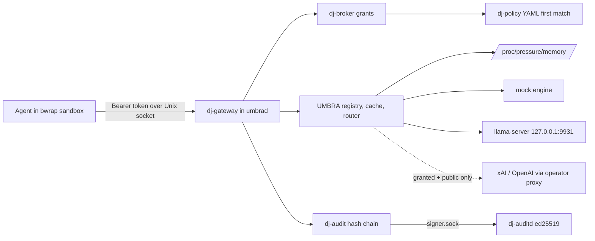

# DARKJUANDER: Technical Requirements Document

| Field | Value |
| --- | --- |
| Project | DARKJUANDER |
| Document | Technical Requirements Document |
| Document ID | DJR-TRD |
| Version | 1.2 |
| Status | In build (Phase 0: v0.1.1 published 2026-10-30 as a signed GitHub Release and GHCR image; qcow2 QEMU-smoke-tested on CI runners; never booted in UTM or on Apple hardware) |
| Date last updated | 2026-10-30 (America/New_York, EDT) |
| Author | Grok Bot documentation agent, for owner Jaamal (Anthony Jaamal Jones) |
| Repo | https://github.com/Awkward8787/DARKJUANDER (public, created 2026-10-27 11:37 PM EDT; default branch `main`) |
| Commit described | `ba652a285a` (full `ba652a285aac4a281f807bdb65570cf4c5c005d0`; 2026-10-30 10:58 AM EDT, PR #15 "Mirror the Fedora bootc 45 pin into GHCR"; tag `v0.1.1`). Previous: `9660261cbc` (PR #14) |
| Live URL | No hosted site. Release [v0.1.1](https://github.com/Awkward8787/DARKJUANDER/releases/tag/v0.1.1); container `ghcr.io/awkward8787/darkjuander:v0.1.1` (= `:latest`, index `sha256:02f054ac30b3…`, cosign-signed) |

## Table of contents

1. [Architecture overview](#1-architecture-overview)
2. [Tech stack](#2-tech-stack)
3. [Repository structure](#3-repository-structure)
4. [Environments](#4-environments)
5. [Configuration and secrets](#5-configuration-and-secrets)
6. [Third-party integrations](#6-third-party-integrations)
7. [Security requirements and implementation](#7-security-requirements-and-implementation)
8. [Privacy implementation](#8-privacy-implementation)
9. [Performance](#9-performance)
10. [Accessibility implementation](#10-accessibility-implementation)
11. [Build, CI and deploy](#11-build-ci-and-deploy)
12. [Testing](#12-testing)
13. [Technical debt](#13-technical-debt)
14. [Glossary](#14-glossary)
15. [Open questions](#15-open-questions)
16. [Changelog](#16-changelog)
17. [Sources](#17-sources)

## 1. Architecture overview


Caption: request path inside `dj-base`. An agent calls `umbrad` over `/run/darkjuander/umbrad.sock` with a bearer token. The gateway authenticates the principal, resolves message labels (span handles raise the session floor), asks the broker (grants, then policy) and UMBRA's router (hard rules drop candidates, then the PSI scorer picks), calls the engine, labels output, and appends an audit record that `dj-auditd` checkpoints.

## 2. Tech stack

| Layer | Technology | Version / note |
| --- | --- | --- |
| Language | Rust | 1.99.1 pinned (`rust-toolchain.toml`); `rust-version = 1.83`; edition 2021 |
| HTTP | axum / hyper / tower / hyper-util | 0.7.9 / 1.5.1 / 0.5.1 / 0.1.10 |
| Async | tokio | 1.41.1 |
| Serialization | serde, serde_json, serde_yaml, toml | 1.0.210 / 1.0.132 / 0.9.34 / 0.8.19 |
| Crypto | sha2, ed25519-dalek, getrandom; jsonwebtoken (SIWC ID tokens) | 0.10.8 / 2.1.1 / 0.2.15 / 9.3.1 |
| HTTP client | ureq (tls, json) | 2.12.1 |
| Sandbox | landlock crate, libc, bubblewrap (executed) | 0.4.4 / 0.2.161 |
| CLI | clap | 4.5.20 |
| Base OS | Fedora bootc 45 | `ghcr.io/awkward8787/fedora-bootc@sha256:479ad7d16893891ea21c774536b11e26cd5b87fa59636a902700cbe438cee634` (pin file `image/fedora-bootc.digest`; the index Quay served for `quay.io/fedora/fedora-bootc:45` on 2026-10-30; PR #15). Earlier pins `0688bb4f…241b` and `ed6ebf92…bbc5` |
| Optional engine | llama.cpp v0.8.0, SmolLM2-135M Q4_K_M GGUF | not vendored |
| CI | GitHub Actions `ci.yml` (ubuntu-24.04): jobs `test`, `branding`, `image-branding` | fmt, clippy -D warnings, tests, demos, shellcheck (`scripts/*.sh image/*.sh`), 10 release-script tests, Containerfile and kernel-config checks, brand build check, podman image build + initramfs check |
| Release | `.github/workflows/release.yml`; runners `ubuntu-24.04-arm` (aarch64) and `ubuntu-24.04` (x86_64) | podman, bootc-image-builder (via `scripts/build-release-disk.sh`), zstd, QEMU (`qemu-system-arm`/`qemu-efi-aarch64`, `qemu-system-x86`/`ovmf`), skopeo |
| Signing | sigstore/cosign-installer v4.1.2 (SHA-pinned), cosign v2.5.3, keyless (GitHub OIDC → Fulcio, Rekor) | `sign-blob` for `SHA256SUMS`; `sign` + `verify` for GHCR digests |
| Registry | GHCR `ghcr.io/awkward8787/darkjuander` (release) and `ghcr.io/awkward8787/fedora-bootc` (base mirror) | Both public (anonymous pull works, 2026-10-30) |
| Mirror tooling | skopeo; `scripts/mirror-fedora-bootc.sh --check` / `--write` | `skopeo copy --all --preserve-digests` to the pin tag; refuses the release image name; never deletes or moves tags |
| Release publishing | softprops/action-gh-release v2.6.2 (SHA-pinned) | Dependabot PR #13 proposes 3.0.3 |
| Brand tooling | Python 3, fonttools, Pillow, librsvg `rsvg-convert` | `branding/scripts/build.py`, `contrast.py`; removed from the image after generation |
| Boot splash | plymouth, plymouth-scripts, plymouth-plugin-script, plymouth-plugin-label; `generic-logos` replaces `fedora-logos` | Installed by `image/Containerfile` |
| Fonts | Space Grotesk, Inter, JetBrains Mono (SIL OFL 1.1) | Vendored in `branding/src/fonts/` |

## 3. Repository structure

```
image/            Containerfile, systemd units (incl. dj-expire-password.service), nftables, sysctl, sysusers, tmpfiles, draft SELinux,
                  apply-branding.sh, check-initramfs.sh, bootc/10-darkjuander.toml (kargs rhgb quiet), dracut/, fontconfig/, backgrounds/, console-password.txt
branding/         Umbra Eclipse brand kit (proprietary assets; scripts/palette/terminal are Apache-2.0): logo/{eclipse,tag,lattice,route}, plymouth/, grub/ (not installed), wallpapers/, terminal/, os-icon/, web/, social/, research/, src/, scripts/
.github/          workflows/ci.yml, workflows/release.yml, dependabot.yml, ISSUE_TEMPLATE/brand-permission.yml
services/label    integrity/confidentiality labels
services/audit    hash-chained log, signer (dj-auditd binary)
services/policy   YAML rules
services/broker   grants and mediated reads
services/sandbox  bubblewrap plan, Landlock, seccomp denylist
services/umbra    registry, cache, PSI router, mock/llama/remote engines, providers, SIWC
services/gateway  Unix-socket API and the five scenes (+ tests)
services/umbrad   umbrad binary
shell/dj          dj CLI
engines/llama     upstream pin and checksum
bpf/              README only, no programs
policy/default.yaml
examples/         umbrad.yaml, agents/research-agent.toml
scripts/          build-image, build-disk, build-llama, fetch-model, run-demos, check-* scripts; release: build-release-disk.sh, write-disk-config.py, iso-depsolve.sh, smoke-qemu.sh, smoke_marker.py, package-release-assets.sh, release-version.sh, render-release-notes.sh, highest-release-tag.py, assert-index-children.py, cosign-ghcr-auth-check.sh, assert-cosign-docker-config.sh, cosign-ci-probe.sh, test-*.sh
tests/            kernel config fixtures, injection page, bench README
docs/             PRD, PLAN, ROADMAP, BASE, LICENSES, providers, decisions, diagrams, INSTALL, RELEASE_NOTES_TEMPLATE
```
Library/binary split: `services/umbra` is a library and `services/umbrad` the binary to avoid a gateway↔umbra dependency cycle (`docs/PLAN.md`).

## 4. Environments

| Env | How | Notes |
| --- | --- | --- |
| Developer host (Linux) | `cargo test --workspace --locked`; `./scripts/run-demos.sh` | Mock engine; no weights |
| CI (`ci.yml`) | push/PR, `permissions: contents: read`, concurrency `ci-<ref>` cancel-in-progress | `image-branding` builds the Containerfile with stub binaries and runs `check-initramfs.sh`; no disk built |
| Release dry run | `release.yml` on `pull_request` (path-filtered) or `workflow_dispatch` with `dry_run` true | Builds binaries, image, qcow2, ISO, QEMU smoke; artifacts only, version `0.0.0-dry.<12 hex>` |
| Release publish | Push of tag `v*.*.*` (or dispatch with `dry_run` false on a tag ref) | GitHub Release + GHCR; v0.1.1 published 2026-10-30 |
| Guest VM | Download per `docs/INSTALL.md` (UTM: ARM64, 4 CPU/8192 MB for mock, 8/32768 MB for local models, UEFI, no Secure Boot) or self-build with `build-image.sh` + `build-disk.sh` | Never booted in UTM; console login only (inbound dropped, sshd off) |

## 5. Configuration and secrets

| Name | Purpose | Where |
| --- | --- | --- |
| `/etc/darkjuander/umbrad.yaml` | Socket, audit paths, policy path, `local_only` (true), `prefer_cloud` (false), PSI threshold 25.0, `allow_psi_override` (must stay false), models, aliases, engines, principals | Image copies `examples/config/umbrad.yaml` |
| Principal `token` | Bearer token per principal | In `umbrad.yaml`; image ships a documented local placeholder token (local only, socket mode 0600) to be replaced before widening access — value is a documented placeholder, not a secret |
| `{state}/credentials/<id>.key` | Provider API keys (mode 0600, dir 0700) | `/var/lib/darkjuander/credentials`; or systemd `LoadCredential=dj-provider-<id>:` read from `CREDENTIALS_DIRECTORY` (only 0600/0400 accepted) |
| `{state}/providers/registry.yaml` | Provider id, model, key path, `granted` flag (no key) | Optional `provider_registry` in `umbrad.yaml` |
| SIWC token file | OpenAI Sign in with ChatGPT tokens | 0600 file under the state dir |
| `DJ_STATE_DIR` / `--state-dir` | Overrides `/var/lib/darkjuander` | Env / CLI |
| `/var/lib/dj-audit/audit.ed25519` | Audit signing seed (0600, dir 0700, user dj-audit) | Generated by `dj-auditd`; rotate by stopping the signer and regenerating (verifies only with the matching public key) |
| `/run/dj-audit/audit.ed25519.pub`, `/var/lib/dj-audit/audit.ed25519.pub` | Verifying key (not secret) | Published by `dj-auditd` |

**CI/release secrets and identities (names only)**

| Name | Purpose | Where |
| --- | --- | --- |
| `secrets.GITHUB_TOKEN` | `podman login ghcr.io` (root auth file) and `cosign login ghcr.io` (runner `~/.docker/config.json`) for pushes and signature upload; GitHub Release | Ephemeral per run; publish job `permissions: contents: write, id-token: write, packages: write`; config files removed in `logout registries` steps |
| GitHub OIDC token | Keyless cosign identity `https://github.com/Awkward8787/DARKJUANDER/.github/workflows/release.yml@refs/tags/vX.Y.Z`, issuer `https://token.actions.githubusercontent.com` | `id-token: write`; no long-lived signing key exists |
| `image/console-password.txt` | Initial password for console user `dj` on downloadable disks | Committed and published on purpose ("Not a secret"); expired at first boot by `dj-expire-password.service` (`chage -d 0 dj`, marker `/var/lib/darkjuander/dj-password-expired`). Value `darkjuander`, published in the repo, `docs/INSTALL.md` and the v0.1.1 release notes |
| Workflow inputs `dry_run` (default true), `cosign_probe` (default false) | Publish gate; opt-in write-path probe to `ghcr.io/awkward8787/darkjuander-ci-probe` from `main` only | `workflow_dispatch` |

No secret values appear in these docs.

## 6. Third-party integrations

| Service | Endpoint | Auth | Notes |
| --- | --- | --- | --- |
| xAI | `https://api.x.ai/v1` `POST /chat/completions` | Bearer API key | Off until granted; egress blocked by unit until operator drop-in/proxy |
| OpenAI | `https://api.openai.com/v1` `POST /chat/completions`; SIWC `POST /v1/responses` (`store:false`, `stream:true`) | API key, or PKCE public client with scope `chatgpt.tokens.use.direct` (discovery `https://auth.openai.com/.well-known/openid-configuration`, RS256 JWKS checks) | Same label rules |
| llama.cpp server | `http://127.0.0.1:9931` | none (loopback) | Disabled unit `dj-llama.service` |
| Quay | `quay.io/fedora/fedora-bootc@<pinned digest>` (source for the mirror copy only), `quay.io/centos-bootc/bootc-image-builder` | public | Build time only; builds no longer pull the base from Quay |
| GHCR base mirror | `ghcr.io/awkward8787/fedora-bootc` tags `45-479ad7d16893` (and `45`, origin UNCONFIRMED), digest `sha256:479ad7d16893…` | Writes: `GITHUB_TOKEN` with `packages: write` on `mirror publish` (push to `main` in `ci.yml`, or `workflow_dispatch` from `main` in `release.yml`); reads anonymous | Concurrency group `mirror-fedora-bootc` |
| GHCR | `ghcr.io/awkward8787/darkjuander` (tags `vX.Y.Z`, `vX.Y.Z-<arch>`, `latest`, staging `ci-<run>`), probe `ghcr.io/awkward8787/darkjuander-ci-probe` | `GITHUB_TOKEN` | Package public |
| Sigstore (Fulcio, Rekor) | via cosign v2.5.3 | GitHub OIDC | Signatures logged publicly and immutably |
| GitHub Releases | `https://github.com/Awkward8787/DARKJUANDER/releases/download/vX.Y.Z/…` | `GITHUB_TOKEN` | v0.1.1 (2026-10-30) is the only Release |
| Dependabot | `github-actions` ecosystem, `/`, weekly | GitHub | Opened #10-#13 on 2026-10-29 |

Failure handling: timeouts; retries `408`, `429`, `5xx` with backoff; no redirects followed; cleartext refused unless loopback; response bodies never copied into errors; no fallthrough to another provider.

## 7. Security requirements and implementation

- AuthN: `Authorization: Bearer <token>` matched against principals; 401 "missing bearer token" / "unknown token".
- AuthZ: broker checks grants (`model.use:*`, `files.read:<root>`, `provider.use:<id>`), then first-match policy (`private-data-stays-local` deny; `tainted-outbound-or-destructive` approve; `standing-outbound-needs-approval` approve; `allow-reads-and-model-use` allow; default deny). Approve → logged, denied.
- Router hard rule in code: private/secret removed from cloud candidates before scoring; broker re-checks resolved route; adapter refuses non-public requests.
- Sandbox: bwrap with new mount/pid/net/user/ipc/uts/cgroup namespaces, no network, dropped caps; child applies Landlock and a seccomp denylist (`DENIED_SYSCALLS`, kill-process) before exec; agent roots under `/var/lib/darkjuander/agents`.
- Audit signer: Unix socket `/run/dj-audit/signer.sock`, accepts only uid `dj-umbra`, max 8 in-flight clients, max 64 KiB request, signs only records that extend its signed tip; crash-safe checkpoint retries (4 attempts).
- Host: nftables input policy drop (established, loopback, ICMP accepted; forward drop); sysctl `kptr_restrict=2`, `dmesg_restrict=1`, `unprivileged_bpf_disabled=1`, `yama.ptrace_scope=2`, `kexec_load_disabled=1`; sshd disabled.
- `dj provider test` sends the key only to the preset host or loopback unless `--allow-untrusted-host`.
- Supply chain (CI): all actions pinned by commit SHA; `persist-credentials: false`; top-level `permissions: contents: read`; the PR-only `cosign auth` job proves `cosign login` leaves a ghcr.io entry without publishing; publish signs `SHA256SUMS` (`sign-blob --bundle SHA256SUMS.cosign.bundle`), pushes per-arch images and the index only as `ci-<run>` staging tags, signs and verifies each digest with the exact identity, checks the index children (`assert-index-children.py`), then `skopeo copy --preserve-digests` to `:VERSION`, `:VERSION-<arch>`, and `:latest` only if the version is the highest `v*` tag (`highest-release-tag.py`), re-checking digests after each copy; credentials are removed before `action-gh-release`; a final step fails the job if sign, tag or release did not succeed.
- Base image supply chain (PR #15): `image/Containerfile` `FROM ghcr.io/awkward8787/fedora-bootc@<digest>`; `check-containerfile.sh` requires the digest on the FROM instruction itself (a digest in a comment fails) and rejects a Quay FROM; PR, branch and `v*` tag runs only run `mirror-fedora-bootc.sh --check` without `packages: write`.
- Downloadable image login: published default password `darkjuander` for `dj`, expired on first boot; smoke test requires the PAM expiry prompt, a completed change and `sudo` accepting the new password.
- Known accepted gaps: seccomp denylist not allowlist; no content inspection (PE-6/7); no TPM anchor; log not encrypted; SELinux domain draft not loaded; bootc does not enforce the cosign signature (no policy shipped); disk images not signed; v0.1.0 GHCR image unsigned and public (kept; superseded by signed v0.1.1); staging `ci-<run>` tags accumulate (failed runs can leave unsigned ones); headless image ships desktop assets (PR #4 P2, accepted); PR #14 P3 leftovers (C1-C3: `:latest` ranks against git tags and accepts pre-releases; one unit test exercises a function the smoke loop does not call); no outside review.

## 8. Privacy implementation

No telemetry. Local-only by default. Cloud calls send only message role/content and model id, never DARKJUANDER labels. Audit records hold provider id, model id, route and token counts; never keys, tokens, private bytes or prompt text. Audit log mode 0600, not encrypted.

## 9. Performance

No measurements. PRD 7.9 targets (e.g. router decision, PSI fallback within 2 s, TTFT on cache hit) are unmeasured; an in-process check that routing returns under 5 ms exists but is not the guest p95 target. Prefix-cache hits do not skip inference yet.

## 10. Accessibility implementation

Not applicable yet: there is no graphical UI on `main`; the `dj` CLI prints plain text. Desktop and approval dialog are planned (FR-015).

## 11. Build, CI and deploy

**CI (`ci.yml`)** job `test`: checkout → Rust 1.99.1 (rustfmt, clippy) → `cargo fmt --check` → `cargo clippy --workspace --all-targets --locked -D warnings` → `cargo test --workspace --locked` → `./scripts/run-demos.sh` → shellcheck `scripts/*.sh image/*.sh` + `test-package-release-assets`, `test-iso-depsolve`, `test-smoke-marker`, `test-release-version`, `test-write-disk-config`, `test-cosign-ghcr-auth-check`, `test-assert-cosign-docker-config`, `test-cosign-ci-probe`, `test-highest-release-tag`, `test-assert-index-children` → `check-containerfile.sh` and kernel-config fixtures. Job `branding`: `check-branding.sh --no-png` and `--check-social` (fails if the committed social PNG/SVG is stale). Job `image-branding`: `podman build` of `image/Containerfile` with stub binaries, which runs `check-initramfs.sh` (theme script path, `Theme=darkjuander`, `Plymouth.ttf`→Inter, initramfs ≤ 140 MiB).

**Release (`release.yml`)**

```mermaid
flowchart LR
  TAG[push tag v*.*.*] --> MC[mirror check: pinned base digest in GHCR]
  MC --> IMG[image job x2 arch: cargo build, podman build, qcow2, QEMU smoke, export container]
  IMG --> ISO[iso job x2: load same image id, Anaconda ISO]
  IMG --> PUB[publish release]
  ISO -.may fail.-> PUB
  PUB --> SUMS[SHA256SUMS + cosign sign-blob]
  SUMS --> PUSH[push ci-run tags + index]
  PUSH --> SIGN[cosign login, sign + verify 3 digests]
  SIGN --> TAGS[skopeo copy to :VERSION, :VERSION-arch, :latest if highest]
  TAGS --> GHR[GitHub Release with assets]
```

Caption: publish order on main after PRs #14 and #15. `mirror check` runs first and fails the run if the pinned base digest is missing from the GHCR mirror; tag runs never write the mirror. The image job builds `dj`/`umbrad`/`dj-auditd` (tarball per arch), the bootc image (`DJ_VERSION` build arg), a qcow2 via `build-release-disk.sh`, compresses with zstd (files over 1900 MiB split into `.partNN`), and boots it under QEMU (`smoke-qemu.sh`, timeout 2400 s aarch64 without KVM, 600 s x86_64). The ISO job reuses the smoke-tested container (image id checked). Publish runs only on a `v` tag ref and only if the image job succeeded; an ISO failure does not block it. Dry runs never publish.

**v0.1.0 (the only tag):** run 40924686961 on `44bec1f1`, started 2026-10-29 1:47 PM EDT. Image and ISO jobs passed for both arches. Publish (pre-#14 workflow) signed `SHA256SUMS`, pushed `:v0.1.0`, per-arch tags and `:latest`, then `cosign sign` failed at 2:22 PM EDT with `UNAUTHORIZED` because `sudo podman login` wrote root's auth file while cosign read the runner's docker config. The GitHub Release step was skipped. PR #14 fixed the login and reordered publish. 

**v0.1.1 (first signed release):** PR #15 (`ba652a28`) merged 2026-10-30 10:58 AM EDT. Tag `v0.1.1` on that commit started release run 41077487909 at 11:05 AM EDT: `mirror check` passed; `image` (aarch64, x86_64) passed including `qemu smoke`; `iso` (both) passed; `publish release` passed every step (sign combined checksums, push multi-arch index, sign image by digest, tag the signed digests, github release); `publish did not finish` was skipped. The GitHub Release was published at 11:51 AM EDT with 11 assets. GHCR now has `v0.1.1` = `latest` = `sha256:02f054ac30b3…`, `v0.1.1-aarch64` = `sha256:569d5334aade…`, `v0.1.1-x86_64` = `sha256:d9b69db53ca7…`, plus staging `ci-41077487909[-arch]` and three `.sig` tags. Checked on the box 2026-10-30: `cosign verify` of `:v0.1.1` against identity `https://github.com/Awkward8787/DARKJUANDER/.github/workflows/release.yml@refs/tags/v0.1.1` and issuer `https://token.actions.githubusercontent.com` passed; `cosign verify-blob` of `SHA256SUMS` with `SHA256SUMS.cosign.bundle` passed; `:v0.1.0` has no signature.

Manual image path unchanged: stage Linux binaries to `out/stage/`, `scripts/build-image.sh`, `scripts/build-disk.sh <authorized_keys>` (no console password set).

**Base mirror (PR #15)**: `ci.yml` job `mirror publish` runs only on a push to `main` (`packages: write`), logs skopeo into ghcr.io with `GITHUB_TOKEN`, runs `sudo ./scripts/mirror-fedora-bootc.sh --write`, then logs out; `image-branding` runs after it and checks the mirror. `release.yml` has `mirror check` (not on `main`, read-only) and `mirror publish` (`workflow_dispatch` from `main` only); `image` needs one of them to succeed. CI also runs `test-mirror-fedora-bootc.sh` (mocked skopeo, no registry) and `test-check-containerfile.sh`.

## 12. Testing

Unit and integration tests per crate (`services/gateway/tests/scenes.rs`, `cloud_providers.rs`; audit chain, signer, poisoned-tip recovery; provider host pinning; label boundary); demo scenes 1-5; kernel config fixtures `tests/fixtures/kernel-{good,bad}.config`; injection page `tests/injection/email-exfil.html`. Reviewer PoCs on the box (`/workspace/djr-pr1-review/poc*`) re-ran the audit chain (11/11), provider exfil vectors (26/26) and label boundary checks for PR #8. Release-side: 10 shell/Python script tests in CI (above); QEMU smoke on each arch requires multi-user target, `UMBRAD_SOCKET_OK`, PAM password-expiry prompt, completed change and `sudo` (`smoke-qemu.sh` exits non-zero unless `password-expired: yes`; v0.1.1 run 41077487909 passed on both arches and its release notes record `multi-user: yes`, `umbrad-socket: yes`, `login-reached: yes`, `password-expired: yes`); mirror tests `test-mirror-fedora-bootc.sh` and `test-check-containerfile.sh` (PR #15); `check-initramfs.sh` mutation-tested by the PR #4 reviewer. Reviews: PR #9 two rounds (`REVIEW-pr9*.md`), PR #14 four rounds (final @ `792ef42`: no P0-P2, three P3s), PR #4 four rounds (final: no P0/P1, one P2 open-accepted).

## 13. Technical debt

See `docs/ROADMAP.md`: BASE-1/3/9, RT-1/2/4, GW-1/2/6, SB-2/5/8, PE-6/7, PB-4/6, AU-3/8, UM-2/5/7/8, UI-1..5. Added in v1.1: unsigned public v0.1.0 on GHCR (kept; `:latest` moved to signed v0.1.1); staging tag accumulation; bootc signature policy not shipped; desktop assets in headless image; PR #14 P3s C1-C3; Dependabot major-version bumps #10-#13 pending; README "What is planned" still says the disk image has not been built (now built in CI, not booted). Added in v1.2: `docs/INSTALL.md` at v0.1.1 still says no newer tag than v0.1.0 exists; the v0.1.0 source can no longer be rebuilt (base digest pruned on Quay); `image/Containerfile` `ARG DJ_VERSION=0.1.0` default (release passes `--build-arg DJ_VERSION=${VERSION}`); PR #16 hardening open; mirror tag `45` of unknown origin.

## 14. Glossary

| Term | Meaning |
| --- | --- |
| DARKJUANDER | Working name of Jaamal's AI-security Linux OS (Vibe Virtue Enterprise LLC); trademark not searched |
| UMBRA | Working name of the userspace "neural core": model registry, trust-partitioned prefix cache and label/PSI-aware router (`services/umbra`, daemon `umbrad`) |
| dj-base | The hardened Fedora bootc 45 image defined by `image/Containerfile` |
| bootc | Image-based Linux: the OS is shipped as an OCI container image with read-only root and A/B updates |
| Label | Pair of integrity (`trusted`/`untrusted`) and confidentiality (`public`/`private`/`secret`) plus origin and owner; joins take the stricter value |
| Session floor | Highest confidentiality a session has touched; once raised, later calls in that session keep it |
| Span handle | Opaque id returned instead of private file bytes by a mediated read |
| PSI | Linux pressure stall information (`/proc/pressure/memory`), used as a router input |
| Principal | A caller identity in `umbrad.yaml` with bearer token, trust domain, `local_only` and grants |
| Grant | Capability string such as `model.use:default-chat`, `files.read:<path>`, `provider.use:xai` |
| Approve decision | Policy result that needs a human prompt; there is no trusted dialog yet, so it is logged and denied (fail-closed) |
| dj-auditd | Separate signer daemon (user `dj-audit`) that signs audit checkpoints with an ed25519 key |
| SIWC | Sign in with ChatGPT, OpenAI's public-client flow used by `dj provider login openai` |
| Umbra Eclipse | Recommended and default logo direction (direction A, `branding/BUILD_DIRECTION` = `eclipse`): dark disc over a violet crescent with a three-node route inside |
| GHCR | GitHub Container Registry; release images go to `ghcr.io/awkward8787/darkjuander` |
| cosign (keyless) | Sigstore signing tool; signs with a short-lived Fulcio certificate bound to the GitHub OIDC identity `…/release.yml@refs/tags/v…`, logged in Rekor |
| Dry run | `release.yml` run from `pull_request` or `workflow_dispatch` with `dry_run` true; builds artifacts but never publishes, version `0.0.0-dry.<12 hex>` |
| Smoke test | `scripts/smoke-qemu.sh`: boots the qcow2 under QEMU on the runner and requires multi-user target, `UMBRAD_SOCKET_OK`, the PAM password-expiry prompt, a completed password change and `sudo` accepting it |
| Staging tag | `ci-<run id>[-arch]` tags the publish job pushes before signing; internal, never to be `bootc switch`ed to |
| Base image mirror | `ghcr.io/awkward8787/fedora-bootc`, a GHCR copy of the Fedora bootc 45 index pinned in `image/fedora-bootc.digest`; written only by `scripts/mirror-fedora-bootc.sh --write` from `main` |
| Pin tag | Mirror tag `45-` plus the first 12 hex digits of the pinned digest (`45-479ad7d16893`); never moved to another digest |

## 15. Open questions

| Question | Owner | Blocks |
| --- | --- | --- |
| v0.1.0 stays public and unsigned at `ghcr.io/awkward8787/darkjuander@sha256:a28c4d2f17fc…` (tags `v0.1.0`, `v0.1.0-aarch64`, `v0.1.0-x86_64`); v0.1.1 replaces it and `:latest` now points at the signed v0.1.1 index. Keep v0.1.0 public indefinitely, or remove it later? (Its source can't be rebuilt: Quay pruned the old base digest.) | Jaamal | Package cleanup |
| `docs/INSTALL.md` at tag v0.1.1 still says "No newer tag has been published" and tells users not to switch to `:latest`. That text predates v0.1.1. Update it in a follow-up code-docs PR? | Jaamal / builder | Accurate install instructions |
| PR #16 ("Harden mirror pins, smoke waits, and latest ranking") is open with green CI. Merge before the next tag? | Jaamal (Lingxi merges) | Next release |
| The base mirror also has a tag `45` on the same digest as `45-479ad7d16893`. `scripts/mirror-fedora-bootc.sh` writes only the `45-<12 hex>` tag, so who created `45` is UNCONFIRMED. Keep or remove? | Builder | Mirror hygiene |
| Published console password: downloadable images ship user `dj` with the published password `darkjuander` (`image/console-password.txt`, documented as not a secret); `dj-expire-password.service` expires it on first boot, and the v0.1.1 QEMU smoke reported `password-expired: yes`. Accept this model long-term, or require first-boot password setup with no default? | Jaamal | Future releases |
| Dependabot PRs #10-#13 bump pinned actions across major versions (checkout 4.4.0→7.0.1, download-artifact 4.3.0→8.0.2, upload-artifact 4.6.2→7.0.2, action-gh-release 2.6.2→3.0.3); CI and release dry runs are green. Merge, and re-review the release path after? | Jaamal / builder | Next release |
| Licensing: the code is Apache-2.0 by a reversible Phase 0 default (`docs/decisions/0001`), not Jaamal's decision. Keep Apache-2.0, choose GPL-3.0, or go source-available/closed? The repo is public. | Jaamal | Public announcements, contributions |

## 16. Changelog

| Date | Version | Change | Reason |
| --- | --- | --- | --- |
| 2026-10-29 | 1.0 | Initial reverse-documented pack from `main` @ `4176cf24` (PRs #1-#3, #5-#8 merged). | Repo moved from empty (awaiting code) to 7 merged PRs on 2026-10-28/29; found in the 2026-10-29 daily docs sync |
| 2026-10-30 | 1.1 | Tech stack (release, cosign, GHCR, Dependabot, brand tooling, fonts; base digest re-pin), repo structure, environments, CI/release secrets (names only), integrations, supply-chain security, build/CI/release incl. v0.1.0 failure, testing, debt | PRs #4 (`a410bf40`, 2026-10-29 12:58 PM EDT), #9 (`44bec1f1`, 1:47 PM EDT) and #14 (`9660261c`, 7:26 PM EDT) merged to `main` (now `9660261cbc`); v0.1.0 tag publish failed; found in the 2026-10-30 daily docs sync |
| 2026-10-30 | 1.2 | Status, base image now from the GHCR mirror (PR #15), console password named (published, not a secret), mirror tooling and integration, release count, base supply-chain controls, v0.1.1 release run and signature checks, mirror jobs, testing, debt | Signed release v0.1.1 (https://github.com/Awkward8787/DARKJUANDER/releases/tag/v0.1.1) published 2026-10-30 11:51 AM EDT from tag on `ba652a28` after PR #15 merged at 10:58 AM EDT; docs PR approved by Jaamal 2:28 PM EDT |

## 17. Sources

- v1.1: cursor-github `compare_commits 4176cf24...9660261c` (3 commits, 166 files) with per-file patches; `get_branch main`; no clone or download
- v1.1: Files read from the patches: `branding/{README.md,BUILD_DIRECTION,LICENSE-BRAND.md,brand-guide.md,src/palette.json,grub/README.md,grub/darkjuander/theme.txt,plymouth/README.md,research/{name-check,competitors,contrast}.md}`, `branding/logo/{eclipse,tag,lattice,route}/svg/*`, `.github/workflows/{ci,release}.yml`, `.github/dependabot.yml`, `.github/ISSUE_TEMPLATE/brand-permission.yml`, `image/Containerfile`, `image/systemd/dj-expire-password.service`, `image/bootc/10-darkjuander.toml`, `image/console-password.txt` (header only; value not copied), `docs/{INSTALL,RELEASE_NOTES_TEMPLATE,BASE,ROADMAP,LICENSES,PRD}.md`, `docs/decisions/0001-phase0-defaults.md`, `README.md`
- v1.1: cursor-github `list_pull_requests` (all; #10-#13 Dependabot open), `list_tags` (only `v0.1.0` → `44bec1f1`), `list_releases` (empty), `list_workflow_runs` (release run 40924686961 on `v0.1.0`: image and iso jobs success, `publish release` failure), `list_workflow_run_jobs`, `get_job_logs` job 123643691424 (cosign `UNAUTHORIZED` at 2026-10-29 2:22 PM EDT)
- v1.1: Anonymous GHCR read 2026-10-30 8:20 AM EDT: `ghcr.io/v2/awkward8787/darkjuander/tags/list` → `v0.1.0-aarch64`, `v0.1.0-x86_64`, `v0.1.0`, `latest`; `v0.1.0` index digest sha256:a28c4d2f17fc3f02cdd59463641fbc875f240ba3e581de733016627613502009; no `.sig` tag
- v1.1: PR bodies #4, #9, #14; review reports `/workspace/djr-pr1-review/REVIEW-pr9*.md`, `REVIEW-pr14-{143d558,8d0c405,b84a598,792ef42}.md`, `/workspace/djr-pr4-review/REVIEW-{b1840e5,2529788}.md`
- v1.1: v1.0 sources: `main` @ `4176cf24` reconstruction, `/workspace/darkjuander/` planning folder, `/workspace/hivemind/master-context.md`
- v1.1: Generator: `/workspace/project-docs/_tools/gen/darkjuander_v1.1_2026-10-30.py`
- v1.2: cursor-github `list_releases` (v0.1.1, published 2026-10-30 11:51 AM EDT, 11 assets incl. `SHA256SUMS` and `SHA256SUMS.cosign.bundle`, release notes), `list_tags` (`v0.1.1` → `ba652a28`, `v0.1.0` → `44bec1f1`), `list_pull_requests` (#15 merged, #16 open, #10-#13 open), `list_pull_request_files` #15, `list_workflow_runs`, `list_workflow_run_jobs` run 41077487909 (all jobs success; mirror publish, cosign auth, cosign probe skipped; `publish did not finish` skipped), `list_branches`
- v1.2: files at tag v0.1.1 read via raw.githubusercontent.com: `scripts/smoke-qemu.sh`, `image/systemd/dj-expire-password.service`, `.github/workflows/release.yml`, `image/Containerfile`, `docs/INSTALL.md`, `docs/ROADMAP.md`, `README.md`; PR #15 and #16 bodies
- v1.2: own checks 2026-10-30 ~2:40 PM EDT with cosign v3 on the box: `cosign verify` of `ghcr.io/awkward8787/darkjuander:v0.1.1` with identity `…/release.yml@refs/tags/v0.1.1` passed (digest `sha256:02f054ac30b3…`, workflow SHA `ba652a28`); `cosign verify-blob` of the release `SHA256SUMS` with its bundle: Verified OK; `cosign verify` of `:v0.1.0` → no signatures found; anonymous GHCR reads: `latest` = `v0.1.1` = `sha256:02f054ac30b3…`, `v0.1.0` = `sha256:a28c4d2f17fc…`, `v0.1.1-aarch64` = `sha256:569d5334aade…`, `v0.1.1-x86_64` = `sha256:d9b69db53ca7…`; `ghcr.io/awkward8787/fedora-bootc` tags `45`, `45-479ad7d16893`, both `sha256:479ad7d16893…`
- v1.2 generator: `/workspace/project-docs/_tools/gen/darkjuander_v1.2_2026-10-30.py`
