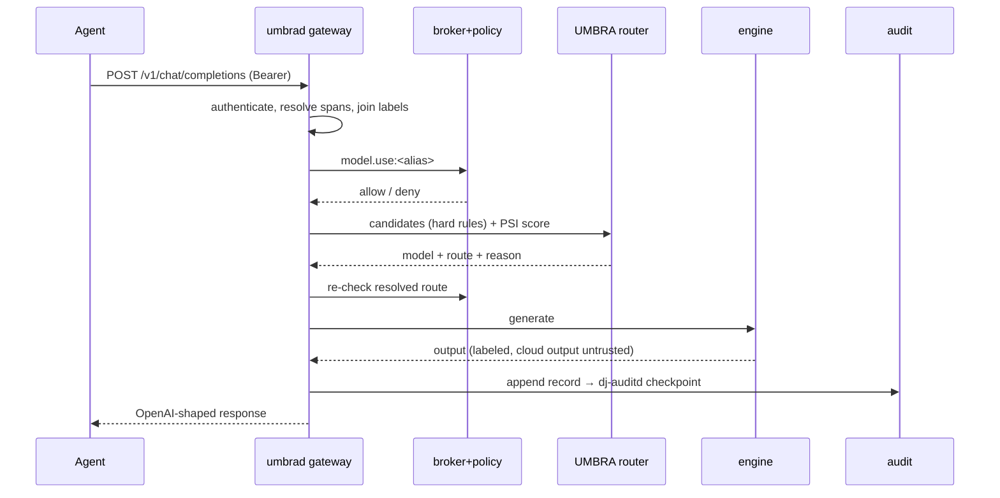
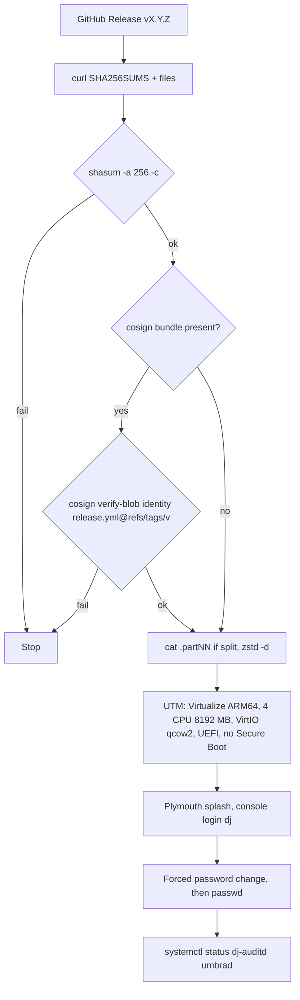

# DARKJUANDER: App Flow

| Field | Value |
| --- | --- |
| Project | DARKJUANDER |
| Document | App Flow |
| Document ID | DJR-FLOW |
| Version | 1.2 |
| Status | In build (Phase 0: v0.1.1 published 2026-10-30 as a signed GitHub Release and GHCR image; qcow2 QEMU-smoke-tested on CI runners; never booted in UTM or on Apple hardware) |
| Date last updated | 2026-10-30 (America/New_York, EDT) |
| Author | Grok Bot documentation agent, for owner Jaamal (Anthony Jaamal Jones) |
| Repo | https://github.com/Awkward8787/DARKJUANDER (public, created 2026-10-27 11:37 PM EDT; default branch `main`) |
| Commit described | `ba652a285a` (full `ba652a285aac4a281f807bdb65570cf4c5c005d0`; 2026-10-30 10:58 AM EDT, PR #15 "Mirror the Fedora bootc 45 pin into GHCR"; tag `v0.1.1`). Previous: `9660261cbc` (PR #14) |
| Live URL | No hosted site. Release [v0.1.1](https://github.com/Awkward8787/DARKJUANDER/releases/tag/v0.1.1); container `ghcr.io/awkward8787/darkjuander:v0.1.1` (= `:latest`, index `sha256:02f054ac30b3…`, cosign-signed) |

## Table of contents

1. [Screen and command inventory](#1-screen-and-command-inventory)
2. [Navigation model](#2-navigation-model)
3. [Main flows](#3-main-flows)
4. [Error and edge states](#4-error-and-edge-states)
5. [Notifications](#5-notifications)
6. [Glossary](#6-glossary)
7. [Open questions](#7-open-questions)
8. [Changelog](#8-changelog)
9. [Sources](#9-sources)

## 1. Screen and command inventory

| Surface | Entry | Who |
| --- | --- | --- |
| `dj demo` | Runs five scenes against mock engine | Developer |
| `dj audit verify <path> [--verifying-key]` | Exit 0 when chain and signed checkpoint match | Operator |
| `dj sandbox plan --manifest <toml>` / `dj sandbox run` | Print or run the bwrap plan | Operator |
| `dj provider add|list|remove|grant|revoke|test|login|model` | Cloud provider lifecycle | Root/operator |
| `umbrad` socket routes | `/health`, `/v1/models`, `/v1/chat/completions`, `/v1/dj/tool`, `/v1/dj/top`, `/v1/dj/admin/psi` | Agents (bearer token), admin |
| Plymouth splash | Boot (Umbra Eclipse icon, wordmark, 240x4 violet progress bar; passphrase entry) | Owner (never seen on a boot) |
| UTM/QEMU console | First login as `dj`, forced password change | Owner |
| GitHub Release page / GHCR | Download qcow2/ISO/binaries + `SHA256SUMS`; `bootc switch` | Owner, testers ([v0.1.1](https://github.com/Awkward8787/DARKJUANDER/releases/tag/v0.1.1) is the only Release) |
| GitHub Actions `release` | Tag push or manual dispatch (`dry_run`, `cosign_probe`) | Maintainer |
| GitHub issue "Brand permission" | Request to use the name/logo | Third parties |

No GUI exists on `main` beyond the Plymouth boot splash. GRUB shows the stock menu (brand GRUB art is not installed).

## 2. Navigation model

CLI subcommands (clap) and HTTP routes over a Unix socket. Agents never talk to engines or the network directly; every call goes through `umbrad`.

## 3. Main flows

**FLOW-001 Chat completion**

Caption: chat path. Errors: 400 empty messages or unknown span; 401 missing/unknown token; 403 broker/policy denial; 502 engine failure; 500 internal.

**FLOW-002 Tool call** (`POST /v1/dj/tool`): action + target → broker grant → policy; `email.send` from untrusted context → approval record → denied (scene 3); `files.read` under a granted root returns a span handle and raises the session floor.

**FLOW-003 Add a cloud provider**: `dj provider add xai --key-file ./xai.key --model MODEL` → `granted:false` → `dj provider grant xai` → edit `umbrad.yaml` (`provider_registry`, `local_only:false`) → caller grants `provider.use:xai` + `model.use:MODEL` → install egress proxy drop-in → `dj provider test xai` sends "ping".

**FLOW-004 Self-built guest (never run in UTM)**: Fedora 45 aarch64 VM in UTM → build image and disk → new UTM VM (Virtualize, ARM64, 8 cores, 32768 MB, UEFI, raw disk) → console login → `check-kernel-config.sh` → optionally enable `dj-llama.service`.

**FLOW-005 Download and install (docs/INSTALL.md; never walked through on a Mac)**

Caption: download path. A missing bundle means the checksum file was unsigned; a failed verify means do not boot. The ISO alternative installs onto an empty VirtIO disk of at least 16 GB. On an existing Fedora bootc host: `sudo bootc switch ghcr.io/awkward8787/darkjuander:vX.Y.Z` then reboot (pin the version; `bootc switch` does not create user `dj`; do not use `ci-<run>` tags or the unsigned `v0.1.0`; `:latest` now resolves to the signed v0.1.1 index, but pin `v0.1.1`). The v0.1.1 release notes give the exact `cosign verify` command for `ghcr.io/awkward8787/darkjuander:v0.1.1`. First console login: user `dj`, published password `darkjuander`, which first boot has already expired, so the console asks for a new password before the shell starts.

**FLOW-006 Release (maintainer)**: push tag `vX.Y.Z` → image jobs (build, qcow2, QEMU smoke) → ISO jobs → publish (checksums signed → staging push → sign/verify → version tags → `:latest` if highest → GitHub Release). Any failure in sign, tag or release fails the job and leaves no Release. On tag runs `mirror check` runs first and fails the run if the pinned base digest is not in the GHCR mirror. Current state: v0.1.1 published 2026-10-30 11:51 AM EDT, all publish steps green.

**FLOW-007 Brand permission**: requester opens the "Brand permission" issue template (fields: what and where; how to reply) → owner answers in writing.

## 4. Error and edge states

Missing `bwrap` → `dj sandbox run` refuses. `workspace = "/"` rejected. Missing credential, bad response or exhausted retries fail the request (no fallthrough). Key file mode other than 0600/0400 refused. Signer busy → bounded retry; poisoned tip recovered. `/v1/dj/admin/psi` returns 404 unless `allow_psi_override` is true. Release: `publish did not finish` message ("Publish did not finish. Version tags and :latest are applied only after the index and per-arch digests verify. This job is a failure."); `refusing container version` for a bad version string; ISO failure does not block publish. GHCR package private → `bootc switch` cannot pull. First boot: login prompts for a new password before the shell starts.

## 5. Notifications

None. Approval prompts are recorded in the audit log and denied; no user-facing prompt exists yet.

## 6. Glossary

| Term | Meaning |
| --- | --- |
| DARKJUANDER | Working name of Jaamal's AI-security Linux OS (Vibe Virtue Enterprise LLC); trademark not searched |
| UMBRA | Working name of the userspace "neural core": model registry, trust-partitioned prefix cache and label/PSI-aware router (`services/umbra`, daemon `umbrad`) |
| dj-base | The hardened Fedora bootc 45 image defined by `image/Containerfile` |
| bootc | Image-based Linux: the OS is shipped as an OCI container image with read-only root and A/B updates |
| Label | Pair of integrity (`trusted`/`untrusted`) and confidentiality (`public`/`private`/`secret`) plus origin and owner; joins take the stricter value |
| Session floor | Highest confidentiality a session has touched; once raised, later calls in that session keep it |
| Span handle | Opaque id returned instead of private file bytes by a mediated read |
| PSI | Linux pressure stall information (`/proc/pressure/memory`), used as a router input |
| Principal | A caller identity in `umbrad.yaml` with bearer token, trust domain, `local_only` and grants |
| Grant | Capability string such as `model.use:default-chat`, `files.read:<path>`, `provider.use:xai` |
| Approve decision | Policy result that needs a human prompt; there is no trusted dialog yet, so it is logged and denied (fail-closed) |
| dj-auditd | Separate signer daemon (user `dj-audit`) that signs audit checkpoints with an ed25519 key |
| SIWC | Sign in with ChatGPT, OpenAI's public-client flow used by `dj provider login openai` |
| Umbra Eclipse | Recommended and default logo direction (direction A, `branding/BUILD_DIRECTION` = `eclipse`): dark disc over a violet crescent with a three-node route inside |
| GHCR | GitHub Container Registry; release images go to `ghcr.io/awkward8787/darkjuander` |
| cosign (keyless) | Sigstore signing tool; signs with a short-lived Fulcio certificate bound to the GitHub OIDC identity `…/release.yml@refs/tags/v…`, logged in Rekor |
| Dry run | `release.yml` run from `pull_request` or `workflow_dispatch` with `dry_run` true; builds artifacts but never publishes, version `0.0.0-dry.<12 hex>` |
| Smoke test | `scripts/smoke-qemu.sh`: boots the qcow2 under QEMU on the runner and requires multi-user target, `UMBRAD_SOCKET_OK`, the PAM password-expiry prompt, a completed password change and `sudo` accepting it |
| Staging tag | `ci-<run id>[-arch]` tags the publish job pushes before signing; internal, never to be `bootc switch`ed to |
| Base image mirror | `ghcr.io/awkward8787/fedora-bootc`, a GHCR copy of the Fedora bootc 45 index pinned in `image/fedora-bootc.digest`; written only by `scripts/mirror-fedora-bootc.sh --write` from `main` |
| Pin tag | Mirror tag `45-` plus the first 12 hex digits of the pinned digest (`45-479ad7d16893`); never moved to another digest |

## 7. Open questions

| Question | Owner | Blocks |
| --- | --- | --- |
| v0.1.0 stays public and unsigned at `ghcr.io/awkward8787/darkjuander@sha256:a28c4d2f17fc…` (tags `v0.1.0`, `v0.1.0-aarch64`, `v0.1.0-x86_64`); v0.1.1 replaces it and `:latest` now points at the signed v0.1.1 index. Keep v0.1.0 public indefinitely, or remove it later? (Its source can't be rebuilt: Quay pruned the old base digest.) | Jaamal | Package cleanup |
| `docs/INSTALL.md` at tag v0.1.1 still says "No newer tag has been published" and tells users not to switch to `:latest`. That text predates v0.1.1. Update it in a follow-up code-docs PR? | Jaamal / builder | Accurate install instructions |
| Published console password: downloadable images ship user `dj` with the published password `darkjuander` (`image/console-password.txt`, documented as not a secret); `dj-expire-password.service` expires it on first boot, and the v0.1.1 QEMU smoke reported `password-expired: yes`. Accept this model long-term, or require first-boot password setup with no default? | Jaamal | Future releases |

## 8. Changelog

| Date | Version | Change | Reason |
| --- | --- | --- | --- |
| 2026-10-29 | 1.0 | Initial reverse-documented pack from `main` @ `4176cf24` (PRs #1-#3, #5-#8 merged). | Repo moved from empty (awaiting code) to 7 merged PRs on 2026-10-28/29; found in the 2026-10-29 daily docs sync |
| 2026-10-30 | 1.1 | Fixed FLOW-001 sequence diagram (a semicolon broke mermaid rendering). Inventory (Plymouth splash, release page, Actions, brand-permission issue), FLOW-005 download/install, FLOW-006 release, FLOW-007 brand permission, release and first-boot edge states | PRs #4 (`a410bf40`, 2026-10-29 12:58 PM EDT), #9 (`44bec1f1`, 1:47 PM EDT) and #14 (`9660261c`, 7:26 PM EDT) merged to `main` (now `9660261cbc`); v0.1.0 tag publish failed; found in the 2026-10-30 daily docs sync |
| 2026-10-30 | 1.2 | Release page inventory, FLOW-005 install notes (v0.1.1 signed, `:latest` moved, first-login password expiry), FLOW-006 mirror check and v0.1.1 state | Signed release v0.1.1 (https://github.com/Awkward8787/DARKJUANDER/releases/tag/v0.1.1) published 2026-10-30 11:51 AM EDT from tag on `ba652a28` after PR #15 merged at 10:58 AM EDT; docs PR approved by Jaamal 2:28 PM EDT |

## 9. Sources

- v1.1: cursor-github `compare_commits 4176cf24...9660261c` (3 commits, 166 files) with per-file patches; `get_branch main`; no clone or download
- v1.1: Files read from the patches: `branding/{README.md,BUILD_DIRECTION,LICENSE-BRAND.md,brand-guide.md,src/palette.json,grub/README.md,grub/darkjuander/theme.txt,plymouth/README.md,research/{name-check,competitors,contrast}.md}`, `branding/logo/{eclipse,tag,lattice,route}/svg/*`, `.github/workflows/{ci,release}.yml`, `.github/dependabot.yml`, `.github/ISSUE_TEMPLATE/brand-permission.yml`, `image/Containerfile`, `image/systemd/dj-expire-password.service`, `image/bootc/10-darkjuander.toml`, `image/console-password.txt` (header only; value not copied), `docs/{INSTALL,RELEASE_NOTES_TEMPLATE,BASE,ROADMAP,LICENSES,PRD}.md`, `docs/decisions/0001-phase0-defaults.md`, `README.md`
- v1.1: cursor-github `list_pull_requests` (all; #10-#13 Dependabot open), `list_tags` (only `v0.1.0` → `44bec1f1`), `list_releases` (empty), `list_workflow_runs` (release run 40924686961 on `v0.1.0`: image and iso jobs success, `publish release` failure), `list_workflow_run_jobs`, `get_job_logs` job 123643691424 (cosign `UNAUTHORIZED` at 2026-10-29 2:22 PM EDT)
- v1.1: Anonymous GHCR read 2026-10-30 8:20 AM EDT: `ghcr.io/v2/awkward8787/darkjuander/tags/list` → `v0.1.0-aarch64`, `v0.1.0-x86_64`, `v0.1.0`, `latest`; `v0.1.0` index digest sha256:a28c4d2f17fc3f02cdd59463641fbc875f240ba3e581de733016627613502009; no `.sig` tag
- v1.1: PR bodies #4, #9, #14; review reports `/workspace/djr-pr1-review/REVIEW-pr9*.md`, `REVIEW-pr14-{143d558,8d0c405,b84a598,792ef42}.md`, `/workspace/djr-pr4-review/REVIEW-{b1840e5,2529788}.md`
- v1.1: v1.0 sources: `main` @ `4176cf24` reconstruction, `/workspace/darkjuander/` planning folder, `/workspace/hivemind/master-context.md`
- v1.1: Generator: `/workspace/project-docs/_tools/gen/darkjuander_v1.1_2026-10-30.py`
- v1.2: cursor-github `list_releases` (v0.1.1, published 2026-10-30 11:51 AM EDT, 11 assets incl. `SHA256SUMS` and `SHA256SUMS.cosign.bundle`, release notes), `list_tags` (`v0.1.1` → `ba652a28`, `v0.1.0` → `44bec1f1`), `list_pull_requests` (#15 merged, #16 open, #10-#13 open), `list_pull_request_files` #15, `list_workflow_runs`, `list_workflow_run_jobs` run 41077487909 (all jobs success; mirror publish, cosign auth, cosign probe skipped; `publish did not finish` skipped), `list_branches`
- v1.2: files at tag v0.1.1 read via raw.githubusercontent.com: `scripts/smoke-qemu.sh`, `image/systemd/dj-expire-password.service`, `.github/workflows/release.yml`, `image/Containerfile`, `docs/INSTALL.md`, `docs/ROADMAP.md`, `README.md`; PR #15 and #16 bodies
- v1.2: own checks 2026-10-30 ~2:40 PM EDT with cosign v3 on the box: `cosign verify` of `ghcr.io/awkward8787/darkjuander:v0.1.1` with identity `…/release.yml@refs/tags/v0.1.1` passed (digest `sha256:02f054ac30b3…`, workflow SHA `ba652a28`); `cosign verify-blob` of the release `SHA256SUMS` with its bundle: Verified OK; `cosign verify` of `:v0.1.0` → no signatures found; anonymous GHCR reads: `latest` = `v0.1.1` = `sha256:02f054ac30b3…`, `v0.1.0` = `sha256:a28c4d2f17fc…`, `v0.1.1-aarch64` = `sha256:569d5334aade…`, `v0.1.1-x86_64` = `sha256:d9b69db53ca7…`; `ghcr.io/awkward8787/fedora-bootc` tags `45`, `45-479ad7d16893`, both `sha256:479ad7d16893…`
- v1.2 generator: `/workspace/project-docs/_tools/gen/darkjuander_v1.2_2026-10-30.py`
