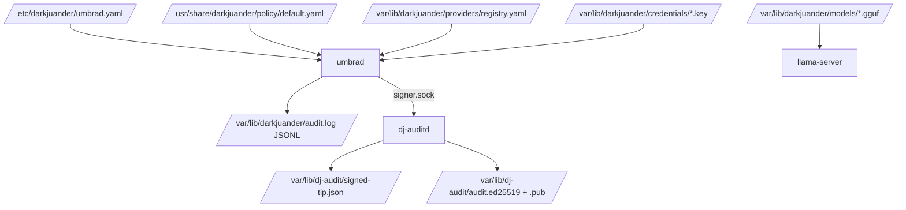
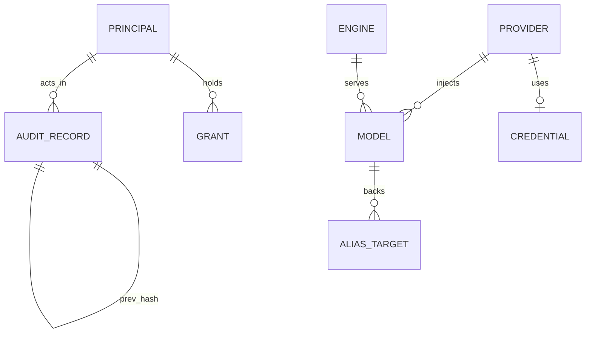

# DARKJUANDER: Backend Schema

| Field | Value |
| --- | --- |
| Project | DARKJUANDER |
| Document | Backend Schema |
| Document ID | DJR-SCHEMA |
| Version | 1.2 |
| Status | In build (Phase 0: v0.1.1 published 2026-10-30 as a signed GitHub Release and GHCR image; qcow2 QEMU-smoke-tested on CI runners; never booted in UTM or on Apple hardware) |
| Date last updated | 2026-10-30 (America/New_York, EDT) |
| Author | Grok Bot documentation agent, for owner Jaamal (Anthony Jaamal Jones) |
| Repo | https://github.com/Awkward8787/DARKJUANDER (public, created 2026-10-27 11:37 PM EDT; default branch `main`) |
| Commit described | `ba652a285a` (full `ba652a285aac4a281f807bdb65570cf4c5c005d0`; 2026-10-30 10:58 AM EDT, PR #15 "Mirror the Fedora bootc 45 pin into GHCR"; tag `v0.1.1`). Previous: `9660261cbc` (PR #14) |
| Live URL | No hosted site. Release [v0.1.1](https://github.com/Awkward8787/DARKJUANDER/releases/tag/v0.1.1); container `ghcr.io/awkward8787/darkjuander:v0.1.1` (= `:latest`, index `sha256:02f054ac30b3…`, cosign-signed) |

## Table of contents

1. [Data architecture overview](#1-data-architecture-overview)
2. [Entity-relationship diagram](#2-entity-relationship-diagram)
3. [Entity definitions](#3-entity-definitions)
4. [Client-side storage](#4-client-side-storage)
5. [API reference](#5-api-reference)
6. [Third-party API calls made by the server](#6-third-party-api-calls-made-by-the-server)
7. [Webhooks](#7-webhooks)
8. [Background jobs](#8-background-jobs)
9. [File and object storage](#9-file-and-object-storage)
10. [Data lifecycle](#10-data-lifecycle)
11. [Migrations and seeding](#11-migrations-and-seeding)
12. [Security of data](#12-security-of-data)
13. [Glossary](#13-glossary)
14. [Open questions](#14-open-questions)
15. [Changelog](#15-changelog)
16. [Sources](#16-sources)

## 1. Data architecture overview

No database. Data lives in YAML/TOML config, a JSONL audit log, signer state files, credential files and in-memory registries.

Caption: where each kind of data lives on `dj-base`.

## 2. Entity-relationship diagram

Caption: logical entities in config and logs.

## 3. Entity definitions

| Entity | Fields | Notes |
| --- | --- | --- |
| Audit `Record` (JSONL line) | `seq` u64, `time` string, `kind`, `actor`, `action`, `outcome`, `reason`, `labels` {integrity, confidentiality, origin, owner}, `details` JSON, `prev_hash` hex, `hash` hex (SHA-256) | Genesis `prev_hash` is 64 zeros; mode 0600; no private bytes, keys or prompt text |
| `Labels` | integrity `trusted`/`untrusted`; confidentiality `public`/`private`/`secret`; origin; owner | Join = max |
| Principal (umbrad.yaml) | `id`, `token`, `trust_domain`, `local_only`, `grants[]` | Example `console` principal in image config |
| Model | `engine`, `location` local/cloud, `size` small/mid, `memory_mb` | `small-local` 2500 MB, `mid-local` 8000 MB (mock) |
| Alias | `default-chat`: {small: small-local, mid: mid-local} |  |
| Engine | `kind` mock / llama-cpp (`base_url`) / openai-compatible |  |
| Policy rule | `id`, `description`, `match` {confidentiality_at_least, route, integrity, action_class_any}, `decision` allow/deny/approve, `reason` | `version: 1`, `default_decision: deny` |
| Provider registry entry | provider id, `default_model`, key path or systemd credential name, `granted` bool | No key material |
| Agent manifest (TOML) | `name`, `version`, `publisher`, `trust_domain`, `workspace`, `capabilities[]`, `memory_max`, `pids_max` | Example `examples/agents/research-agent.toml` (1G, 64 pids) |
| Signer tip | `signed-tip.json` (last signed head); legacy `signed-records.jsonl` | /var/lib/dj-audit |

## 4. Client-side storage

Not applicable (no browser client).

## 5. API reference

| ID | Method | Path | Auth | Purpose |
| --- | --- | --- | --- | --- |
| API-001 | GET | /health | none | Liveness |
| API-002 | GET | /v1/models | Bearer | Models/aliases the caller may use |
| API-003 | POST | /v1/chat/completions | Bearer | OpenAI-shaped chat; body `model`, `messages` (content or span refs, labels); no streaming |
| API-004 | POST | /v1/dj/tool | Bearer | Mediated tool action `{action, target, …}` through broker and policy |
| API-005 | GET | /v1/dj/top | Bearer (admin) | Registry, residency, callers, routes; 403 for non-admin |
| API-006 | POST | /v1/dj/admin/psi | Bearer (admin) | Test-only PSI override; 404 unless `allow_psi_override: true` |

Transport: HTTP over Unix socket `/run/darkjuander/umbrad.sock` (mode 0600, owner dj-umbra). Errors return `ApiError` JSON with a message; statuses 400, 401, 403, 404, 500, 502. Implementing files: `services/gateway/src/lib.rs`, `handlers.rs`.

## 6. Third-party API calls made by the server

`POST {base}/chat/completions` (xAI, OpenAI; payload: model id + messages role/content), `POST https://api.openai.com/v1/responses` (SIWC, `store:false`, `stream:true`), llama-server OpenAI subset on loopback. Token counts mapped into audit `details`.

## 7. Webhooks

None.

## 8. Background jobs

`dj-auditd.service` (signer, long-running), `umbrad.service`, optional `dj-llama.service`. `dj-expire-password.service` (oneshot, first boot only: `chage -d 0 dj`, then touches `/var/lib/darkjuander/dj-password-expired`; skipped when that marker exists). No cron jobs. CI-side scheduled job: Dependabot weekly (`github-actions`).

## 9. File and object storage

| Path | Mode/owner | Content |
| --- | --- | --- |
| /var/lib/darkjuander | 0750 dj-umbra | state, audit.log |
| /var/lib/darkjuander/models | 0750 dj-umbra | GGUF weights (downloaded, not committed) |
| /var/lib/darkjuander/credentials | 0700 dj-umbra | provider keys 0600 |
| /var/lib/darkjuander/providers | 0700 dj-umbra | registry.yaml |
| /run/darkjuander | 0750 dj-umbra | umbrad.sock |
| /var/lib/dj-audit | 0700 dj-audit | seed, tip, durable pub key |
| /run/dj-audit | 0750 dj-audit:dj-umbra | signer.sock, pub key |
| /var/lib/darkjuander/agents/<name> | per agent | sandbox workspaces |
| /var/lib/darkjuander/dj-password-expired | root | First-boot marker for the password expiry |
| /usr/share/plymouth/themes/darkjuander | root (image) | Boot splash theme (also inside the initramfs) |
| /usr/share/backgrounds/darkjuander, /usr/share/gnome-background-properties/darkjuander.xml | root (image) | Wallpapers |
| /usr/share/icons/hicolor/…/darkjuander.*, /usr/share/pixmaps/darkjuander.png | root (image) | OS icon |
| /usr/share/fonts/darkjuander | root (image) | OFL fonts + licenses |
| /usr/share/darkjuander/terminal | root (image) | Terminal schemes |
| /usr/lib/bootc/install/00-darkjuander.toml, /usr/lib/bootc/kargs.d/10-darkjuander.toml | root (image) | xfs root; kargs `rhgb quiet` |
| /usr/libexec/darkjuander/check-initramfs.sh | root (image) | Initramfs check |

**Release artifacts (off-device)**: GitHub Release assets `darkjuander-<ver>-<arch>.qcow2.zst`, `darkjuander-<ver>-<arch>.iso.zst`, `darkjuander-binaries-<ver>-<arch>.tar.gz` (split as `.partNN` over 1900 MiB), `SHA256SUMS`, `SHA256SUMS.cosign.bundle`, `RELEASE_NOTES.md`. Published for v0.1.1 only: `darkjuander-binaries-v0.1.1-{aarch64,x86_64}.tar.gz`, `darkjuander-v0.1.1-{aarch64,x86_64}.qcow2.zst`, `darkjuander-v0.1.1-{aarch64,x86_64}.iso.zst.part00/.part01`, `SHA256SUMS`, `SHA256SUMS.cosign.bundle`, `RELEASE_NOTES.md` (11 assets). GHCR `ghcr.io/awkward8787/darkjuander`: signed `v0.1.1` = `latest` (index `sha256:02f054ac30b3…`), `v0.1.1-aarch64`, `v0.1.1-x86_64`; unsigned `v0.1.0`, `v0.1.0-aarch64`, `v0.1.0-x86_64` (index `sha256:a28c4d2f17fc…`, kept); staging `ci-41077487909[-arch]`; cosign signature tags `sha256-<digest>.sig` for the three v0.1.1 digests. Base mirror `ghcr.io/awkward8787/fedora-bootc`: `45-479ad7d16893` and `45`, both `sha256:479ad7d16893…`; the pin itself is the one-line file `image/fedora-bootc.digest`. Staging tags `ci-<run>[-arch]` are never deleted (deleting a GHCR version would remove any release tag on the same digest).

## 10. Data lifecycle

No retention policy or rotation for the audit log yet (UNCONFIRMED/Planned). `dj provider remove` deletes the provider and shreds its local credential. bootc keeps `/var` across A/B updates. Workflow artifacts follow GitHub's default artifact retention (not set in `release.yml`; UNCONFIRMED). GHCR images and staging tags are kept indefinitely.

## 11. Migrations and seeding

None (no database). Config is replaced by image updates under `/usr`; `/etc` and `/var` persist.

## 12. Security of data

SHA-256 hash chain plus ed25519 checkpoints by a separate uid; key files owner-only; no encryption at rest for the log; no TPM sealing.

## 13. Glossary

| Term | Meaning |
| --- | --- |
| DARKJUANDER | Working name of Jaamal's AI-security Linux OS (Vibe Virtue Enterprise LLC); trademark not searched |
| UMBRA | Working name of the userspace "neural core": model registry, trust-partitioned prefix cache and label/PSI-aware router (`services/umbra`, daemon `umbrad`) |
| dj-base | The hardened Fedora bootc 45 image defined by `image/Containerfile` |
| bootc | Image-based Linux: the OS is shipped as an OCI container image with read-only root and A/B updates |
| Label | Pair of integrity (`trusted`/`untrusted`) and confidentiality (`public`/`private`/`secret`) plus origin and owner; joins take the stricter value |
| Session floor | Highest confidentiality a session has touched; once raised, later calls in that session keep it |
| Span handle | Opaque id returned instead of private file bytes by a mediated read |
| PSI | Linux pressure stall information (`/proc/pressure/memory`), used as a router input |
| Principal | A caller identity in `umbrad.yaml` with bearer token, trust domain, `local_only` and grants |
| Grant | Capability string such as `model.use:default-chat`, `files.read:<path>`, `provider.use:xai` |
| Approve decision | Policy result that needs a human prompt; there is no trusted dialog yet, so it is logged and denied (fail-closed) |
| dj-auditd | Separate signer daemon (user `dj-audit`) that signs audit checkpoints with an ed25519 key |
| SIWC | Sign in with ChatGPT, OpenAI's public-client flow used by `dj provider login openai` |
| Umbra Eclipse | Recommended and default logo direction (direction A, `branding/BUILD_DIRECTION` = `eclipse`): dark disc over a violet crescent with a three-node route inside |
| GHCR | GitHub Container Registry; release images go to `ghcr.io/awkward8787/darkjuander` |
| cosign (keyless) | Sigstore signing tool; signs with a short-lived Fulcio certificate bound to the GitHub OIDC identity `…/release.yml@refs/tags/v…`, logged in Rekor |
| Dry run | `release.yml` run from `pull_request` or `workflow_dispatch` with `dry_run` true; builds artifacts but never publishes, version `0.0.0-dry.<12 hex>` |
| Smoke test | `scripts/smoke-qemu.sh`: boots the qcow2 under QEMU on the runner and requires multi-user target, `UMBRAD_SOCKET_OK`, the PAM password-expiry prompt, a completed password change and `sudo` accepting it |
| Staging tag | `ci-<run id>[-arch]` tags the publish job pushes before signing; internal, never to be `bootc switch`ed to |
| Base image mirror | `ghcr.io/awkward8787/fedora-bootc`, a GHCR copy of the Fedora bootc 45 index pinned in `image/fedora-bootc.digest`; written only by `scripts/mirror-fedora-bootc.sh --write` from `main` |
| Pin tag | Mirror tag `45-` plus the first 12 hex digits of the pinned digest (`45-479ad7d16893`); never moved to another digest |

## 14. Open questions

| Question | Owner | Blocks |
| --- | --- | --- |
| v0.1.0 stays public and unsigned at `ghcr.io/awkward8787/darkjuander@sha256:a28c4d2f17fc…` (tags `v0.1.0`, `v0.1.0-aarch64`, `v0.1.0-x86_64`); v0.1.1 replaces it and `:latest` now points at the signed v0.1.1 index. Keep v0.1.0 public indefinitely, or remove it later? (Its source can't be rebuilt: Quay pruned the old base digest.) | Jaamal | Package cleanup |
| The base mirror also has a tag `45` on the same digest as `45-479ad7d16893`. `scripts/mirror-fedora-bootc.sh` writes only the `45-<12 hex>` tag, so who created `45` is UNCONFIRMED. Keep or remove? | Builder | Mirror hygiene |
| Published console password: downloadable images ship user `dj` with the published password `darkjuander` (`image/console-password.txt`, documented as not a secret); `dj-expire-password.service` expires it on first boot, and the v0.1.1 QEMU smoke reported `password-expired: yes`. Accept this model long-term, or require first-boot password setup with no default? | Jaamal | Future releases |

## 15. Changelog

| Date | Version | Change | Reason |
| --- | --- | --- | --- |
| 2026-10-29 | 1.0 | Initial reverse-documented pack from `main` @ `4176cf24` (PRs #1-#3, #5-#8 merged). | Repo moved from empty (awaiting code) to 7 merged PRs on 2026-10-28/29; found in the 2026-10-29 daily docs sync |
| 2026-10-30 | 1.1 | New first-boot job and marker file, image-installed brand paths, bootc config files, release artifact and GHCR storage, artifact retention note | PRs #4 (`a410bf40`, 2026-10-29 12:58 PM EDT), #9 (`44bec1f1`, 1:47 PM EDT) and #14 (`9660261c`, 7:26 PM EDT) merged to `main` (now `9660261cbc`); v0.1.0 tag publish failed; found in the 2026-10-30 daily docs sync |
| 2026-10-30 | 1.2 | Release artifacts and GHCR contents after v0.1.1; base mirror package and pin file | Signed release v0.1.1 (https://github.com/Awkward8787/DARKJUANDER/releases/tag/v0.1.1) published 2026-10-30 11:51 AM EDT from tag on `ba652a28` after PR #15 merged at 10:58 AM EDT; docs PR approved by Jaamal 2:28 PM EDT |

## 16. Sources

- v1.1: cursor-github `compare_commits 4176cf24...9660261c` (3 commits, 166 files) with per-file patches; `get_branch main`; no clone or download
- v1.1: Files read from the patches: `branding/{README.md,BUILD_DIRECTION,LICENSE-BRAND.md,brand-guide.md,src/palette.json,grub/README.md,grub/darkjuander/theme.txt,plymouth/README.md,research/{name-check,competitors,contrast}.md}`, `branding/logo/{eclipse,tag,lattice,route}/svg/*`, `.github/workflows/{ci,release}.yml`, `.github/dependabot.yml`, `.github/ISSUE_TEMPLATE/brand-permission.yml`, `image/Containerfile`, `image/systemd/dj-expire-password.service`, `image/bootc/10-darkjuander.toml`, `image/console-password.txt` (header only; value not copied), `docs/{INSTALL,RELEASE_NOTES_TEMPLATE,BASE,ROADMAP,LICENSES,PRD}.md`, `docs/decisions/0001-phase0-defaults.md`, `README.md`
- v1.1: cursor-github `list_pull_requests` (all; #10-#13 Dependabot open), `list_tags` (only `v0.1.0` → `44bec1f1`), `list_releases` (empty), `list_workflow_runs` (release run 40924686961 on `v0.1.0`: image and iso jobs success, `publish release` failure), `list_workflow_run_jobs`, `get_job_logs` job 123643691424 (cosign `UNAUTHORIZED` at 2026-10-29 2:22 PM EDT)
- v1.1: Anonymous GHCR read 2026-10-30 8:20 AM EDT: `ghcr.io/v2/awkward8787/darkjuander/tags/list` → `v0.1.0-aarch64`, `v0.1.0-x86_64`, `v0.1.0`, `latest`; `v0.1.0` index digest sha256:a28c4d2f17fc3f02cdd59463641fbc875f240ba3e581de733016627613502009; no `.sig` tag
- v1.1: PR bodies #4, #9, #14; review reports `/workspace/djr-pr1-review/REVIEW-pr9*.md`, `REVIEW-pr14-{143d558,8d0c405,b84a598,792ef42}.md`, `/workspace/djr-pr4-review/REVIEW-{b1840e5,2529788}.md`
- v1.1: v1.0 sources: `main` @ `4176cf24` reconstruction, `/workspace/darkjuander/` planning folder, `/workspace/hivemind/master-context.md`
- v1.1: Generator: `/workspace/project-docs/_tools/gen/darkjuander_v1.1_2026-10-30.py`
- v1.2: cursor-github `list_releases` (v0.1.1, published 2026-10-30 11:51 AM EDT, 11 assets incl. `SHA256SUMS` and `SHA256SUMS.cosign.bundle`, release notes), `list_tags` (`v0.1.1` → `ba652a28`, `v0.1.0` → `44bec1f1`), `list_pull_requests` (#15 merged, #16 open, #10-#13 open), `list_pull_request_files` #15, `list_workflow_runs`, `list_workflow_run_jobs` run 41077487909 (all jobs success; mirror publish, cosign auth, cosign probe skipped; `publish did not finish` skipped), `list_branches`
- v1.2: files at tag v0.1.1 read via raw.githubusercontent.com: `scripts/smoke-qemu.sh`, `image/systemd/dj-expire-password.service`, `.github/workflows/release.yml`, `image/Containerfile`, `docs/INSTALL.md`, `docs/ROADMAP.md`, `README.md`; PR #15 and #16 bodies
- v1.2: own checks 2026-10-30 ~2:40 PM EDT with cosign v3 on the box: `cosign verify` of `ghcr.io/awkward8787/darkjuander:v0.1.1` with identity `…/release.yml@refs/tags/v0.1.1` passed (digest `sha256:02f054ac30b3…`, workflow SHA `ba652a28`); `cosign verify-blob` of the release `SHA256SUMS` with its bundle: Verified OK; `cosign verify` of `:v0.1.0` → no signatures found; anonymous GHCR reads: `latest` = `v0.1.1` = `sha256:02f054ac30b3…`, `v0.1.0` = `sha256:a28c4d2f17fc…`, `v0.1.1-aarch64` = `sha256:569d5334aade…`, `v0.1.1-x86_64` = `sha256:d9b69db53ca7…`; `ghcr.io/awkward8787/fedora-bootc` tags `45`, `45-479ad7d16893`, both `sha256:479ad7d16893…`
- v1.2 generator: `/workspace/project-docs/_tools/gen/darkjuander_v1.2_2026-10-30.py`
