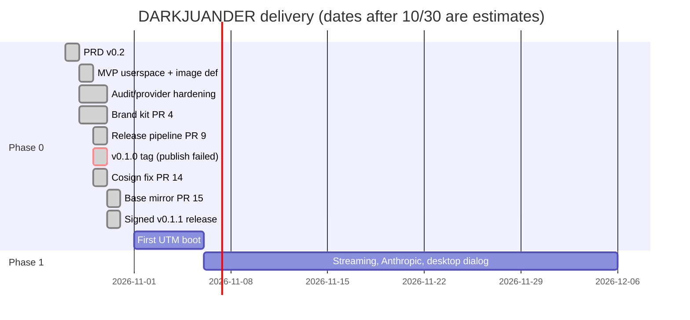

# DARKJUANDER: Implementation Plan

| Field | Value |
| --- | --- |
| Project | DARKJUANDER |
| Document | Implementation Plan |
| Document ID | DJR-PLAN |
| Version | 1.2 |
| Status | In build (Phase 0: v0.1.1 published 2026-10-30 as a signed GitHub Release and GHCR image; qcow2 QEMU-smoke-tested on CI runners; never booted in UTM or on Apple hardware) |
| Date last updated | 2026-10-30 (America/New_York, EDT) |
| Author | Grok Bot documentation agent, for owner Jaamal (Anthony Jaamal Jones) |
| Repo | https://github.com/Awkward8787/DARKJUANDER (public, created 2026-10-27 11:37 PM EDT; default branch `main`) |
| Commit described | `ba652a285a` (full `ba652a285aac4a281f807bdb65570cf4c5c005d0`; 2026-10-30 10:58 AM EDT, PR #15 "Mirror the Fedora bootc 45 pin into GHCR"; tag `v0.1.1`). Previous: `9660261cbc` (PR #14) |
| Live URL | No hosted site. Release [v0.1.1](https://github.com/Awkward8787/DARKJUANDER/releases/tag/v0.1.1); container `ghcr.io/awkward8787/darkjuander:v0.1.1` (= `:latest`, index `sha256:02f054ac30b3…`, cosign-signed) |

## Table of contents

1. [Delivery summary](#1-delivery-summary)
2. [Phases and milestones](#2-phases-and-milestones)
3. [Work breakdown](#3-work-breakdown)
4. [Review gates](#4-review-gates)
5. [Testing and QA plan](#5-testing-and-qa-plan)
6. [Launch checklist](#6-launch-checklist)
7. [Deployment runbook](#7-deployment-runbook)
8. [Post-launch tasks](#8-post-launch-tasks)
9. [Roadmap](#9-roadmap)
10. [Risks and mitigations](#10-risks-and-mitigations)
11. [Maintenance plan](#11-maintenance-plan)
12. [Glossary](#12-glossary)
13. [Open questions](#13-open-questions)
14. [Changelog](#14-changelog)
15. [Sources](#15-sources)

## 1. Delivery summary

Built by Cursor cloud agents for Jaamal between 2026-10-28 and 2026-10-30, with a separate security reviewer on every PR. Current status (main `ba652a28`, 2026-10-30): userspace slice, Umbra Eclipse branding, the release pipeline and the GHCR base mirror are merged and green in CI. v0.1.0 (2026-10-29) failed at cosign image signing and left an unsigned image public. On 2026-10-30 PR #15 moved the base image to a pinned GHCR mirror (merged 10:58 AM EDT), and tag v0.1.1 produced the first signed release (published 11:51 AM EDT): signed `SHA256SUMS`, signed GHCR image, `:latest` moved to it, and QEMU smoke on both arches proving the published console password is expired on first boot. v0.1.0 is kept, unsigned, and replaced by v0.1.1. Open: PR #16 (hardening) and Dependabot #10-#13. Nothing has been booted in UTM.

## 2. Phases and milestones

Caption: milestones; the UTM boot and Phase 1 bars are estimates, not commitments. Everything up to v0.1.1 is done.

## 3. Work breakdown

| ID | Task | Req | PR / commit | Status |
| --- | --- | --- | --- | --- |
| TASK-001 | Initial commit | — | `e73cddc5` 2026-10-28 2:14 PM EDT | Done |
| TASK-002 | Phase 0/1 MVP: UMBRA core, dj services, bootc image definition, demo scenes | FR-001,003-010,013 | #1 `5c9e237b` 2026-10-28 3:24 PM EDT | Done |
| TASK-003 | Audit signer split, crash-safe checkpoints, random span ids | FR-010 | #2 `a1adf614` 4:34 PM EDT | Done |
| TASK-004 | Bound the audit signer, durable verifying key | FR-010 | #3 `0bbe048f` 10:54 PM EDT | Done |
| TASK-005 | xAI and OpenAI as granted cloud routes | FR-011 | #5 `e600508d` 10:54 PM EDT | Done |
| TASK-006 | Poisoned audit tip recovery, busy checkpoint retry | FR-010 | #6 `48e09df5` 2026-10-29 1:01 AM EDT | Done |
| TASK-007 | Provider test host pinning, ChatGPT reauth on stored account | FR-011 | #7 `79574515` 1:01 AM EDT | Done |
| TASK-008 | Observable audit sync and provider egress checks | FR-010,011 | #8 `4176cf24` 1:52 AM EDT | Done |
| TASK-009 | Umbra Eclipse brand kit wired into image | FR-016,019 | #4 `a410bf40` 2026-10-29 12:58 PM EDT | Done |
| TASK-010 | Tag-triggered bootc release workflow (qcow2/ISO, QEMU smoke, cosign), INSTALL docs, Dependabot | FR-002,017,018,020 | #9 `44bec1f1` 1:47 PM EDT | Done |
| TASK-011 | Boot dj-base in UTM; run check-kernel-config in guest; look at Plymouth splash | FR-001,002,016 | — | Planned (image now built in CI) |
| TASK-012 | bootc signature policy; load SELinux domain | FR-014 | — | Planned |
| TASK-013 | Streaming, Anthropic endpoint | FR-004,005 | — | Planned |
| TASK-014 | Desktop + trusted approval dialog + kill switch | FR-015 | — | Planned |
| TASK-015 | Onboard Jaamal's first agents; outside security review | — | — | Planned |
| TASK-016 | Tag v0.1.0 | FR-017 | tag on `44bec1f1`, run 40924686961 | Failed at publish (cosign UNAUTHORIZED); unsigned GHCR image left public |
| TASK-017 | Log cosign into GHCR; sign/verify by digest before tagging; staging tags; `:latest` ranking | FR-014,017 | #14 `9660261c` 7:26 PM EDT | Done |
| TASK-018 | Tag signed v0.1.1 and confirm GitHub Release + signatures | FR-014,017 | tag on `ba652a28`, run 41077487909 | Done 2026-10-30 11:51 AM EDT; signatures verified |
| TASK-019 | Decide fate of unsigned v0.1.0/`latest` on GHCR | — | — | Decided: v0.1.0 kept, v0.1.1 replaces it; `:latest` moved to v0.1.1 |
| TASK-020 | Review and merge Dependabot #10-#13 (major action bumps) | FR-020 | #10-#13 | Open; CI green |
| TASK-021 | Mirror the Fedora bootc 45 pin into GHCR; FROM by digest; read-only checks on PR/tag runs | FR-001, NFR-007 | #15 `ba652a28` 2026-10-30 10:58 AM EDT | Done |
| TASK-022 | Harden mirror pins, smoke waits and `:latest` ranking | FR-017 | #16 (head `863fa20e`) | Open; CI green |
| TASK-023 | Update `docs/INSTALL.md` now that a signed tag exists | FR-018 | — | Open |

## 4. Review gates

| Review | Verdict | Resolution |
| --- | --- | --- |
| PR #1 security review (REVIEW.md) | Honest Phase 0 scaffold; one P0 design gap and several P1s | Follow-up fixes re-reviewed in PRs #2-#3 (see REVIEW-pr2/pr3); whether every PR #1 finding is closed is UNCONFIRMED |
| PR #2 re-reviews | Blind signing oracle (P1-NEW-1) closed | Merged |
| PR #3 | Hygiene fixes effective | Merged |
| PR #5 | No P0/P1; ship-able | Merged; P3s fixed in #7 |
| PR #6, #7 | No P0-P2; ship-able | Merged |
| PR #8 | No findings | Merged |
| PR #9 round 1 | Do not ship: 1 P1, 5 P2, 4 P3 | Fixed at `a7183db`: no P0-P2, one P3; merged 2026-10-29 |
| PR #4 rounds 1-4 | Not ready → latest (`2529788`): no P0/P1, one P2 open-accepted (desktop assets in headless image), four P3s | Merged 2026-10-29 |
| PR #14 round 1 (`143d558`) | 0 P0/P1, 3 P2, 4 P3 | Fixed |
| PR #14 round 2 (`8d0c405`) | 1 P2 (probe could never sign), 8 P3 | Fixed |
| PR #14 round 3 (`b84a598`) | No P0-P2, 7 P3 (B1-B8) | Mostly fixed |
| PR #14 confirm (`792ef42`) | No P0-P2; B3 partly fixed; new P3s C1-C3 | Merged 2026-10-29 |
| PR #15 | CI and release dry run 41070940599 green (both smoke results `password-expired: yes`); separate review report not on the box | Merged 2026-10-30 |
| v0.1.1 tag run 41077487909 | All jobs green; signatures verified independently on the box | Released |
| PR #16 | CI and release dry run 41093015934 green | Open |
| Dependabot #10-#13 | Not reviewed | Open |

No outside (third-party) security review has been done.

## 5. Testing and QA plan

Automated: CI on every push/PR. Manual (planned): boot guest, verify console-only access, run `check-kernel-config.sh`, run demos in guest, PSI fallback under `stress-ng --vm 2 --vm-bytes 80%` within 2 s (unmeasured), llama.cpp end-to-end.

## 6. Launch checklist

| Item | State |
| --- | --- |
| Image built in CI | Done (CI stub build; v0.1.0 and v0.1.1 release runs, both arches) |
| qcow2 QEMU smoke on runner | Done for v0.1.1 (both arches, `password-expired: yes`); not a UTM boot |
| Disk image booted in UTM / Apple hardware | Not done |
| GitHub Release published | Done: [v0.1.1](https://github.com/Awkward8787/DARKJUANDER/releases/tag/v0.1.1), 2026-10-30 11:51 AM EDT |
| Image signed (cosign) | Done for v0.1.1 (index and `SHA256SUMS`, verified 2026-10-30); v0.1.0 unsigned and kept |
| Base image pinned and mirrored | Done (PR #15) |
| bootc signature policy | Not done |
| SELinux domain loaded | Not done |
| Trademark search | First pass done 2026-10-28 (not clearance); attorney search not done |
| License decision | Code Apache-2.0 default (not confirmed by Jaamal); brand assets proprietary per LICENSE-BRAND.md (ownership wording to confirm) |
| Outside security review | Not done |
| No telemetry | Done in image definition |
| GitHub social preview uploaded | UNCONFIRMED |

## 7. Deployment runbook

Developer: `cargo test --workspace --locked && ./scripts/run-demos.sh`. Dry run: Actions → `release` → Run workflow (leave `dry_run` true). Release: push an annotated or lightweight tag `vX.Y.Z` on `main`; watch `image`, `iso`, `publish release`; confirm the GitHub Release has `SHA256SUMS` + `SHA256SUMS.cosign.bundle`, then `cosign verify` the GHCR tag with identity `…/release.yml@refs/tags/vX.Y.Z` and confirm `:latest` moved. If publish fails: no Release is created; version tags are applied only after verification (post-#14), staging `ci-<run>` tags may remain. Install: `docs/INSTALL.md`. Updates: `bootc upgrade`/`bootc switch` (untested). Rollback: bootc rollback (untested). Before tagging, the pinned base digest must already be in `ghcr.io/awkward8787/fedora-bootc` (a push to `main` or a `release` dispatch from `main` copies it); tag runs only check. Verify the image: `cosign verify --certificate-oidc-issuer https://token.actions.githubusercontent.com --certificate-identity "https://github.com/Awkward8787/DARKJUANDER/.github/workflows/release.yml@refs/tags/vX.Y.Z" ghcr.io/awkward8787/darkjuander:vX.Y.Z`. Merges to DARKJUANDER are done by Lingxi on Jaamal's word.

## 8. Post-launch tasks

v0.1.1 is the first signed release; the project is still in build. Pending: update `docs/INSTALL.md` for v0.1.1; decide on PR #16 and Dependabot #10-#13; decide whether the unsigned v0.1.0 stays public long-term; confirm logo direction, tagline and brand-license wording; upload the GitHub social preview; boot v0.1.1 in UTM; see open questions.

## 9. Roadmap

See `docs/ROADMAP.md` and PRD section 11 (Phase 1 MVP in a VM, Phase 2 installable release, Phase 3 stronger isolation, Phase 4 ecosystem).

## 10. Risks and mitigations

Overclaiming security (mitigated by candid docs and reviews); supply-chain drift (digest pins, `--locked`, SHA-pinned actions, Dependabot weekly); approval fatigue; solo bandwidth. Release-specific: the public unsigned v0.1.0 could be mistaken for a release (mitigated: `:latest` and the only GitHub Release are signed v0.1.1; INSTALL.md text is stale and needs updating); a Quay prune of the base digest (mitigated by the GHCR mirror, PR #15).

## 11. Maintenance plan

Bump the pinned Fedora digest and Rust toolchain deliberately; re-run reviews per PR; rotate provider keys via `dj provider remove/add`; regenerate these docs on each merged PR. Review Dependabot action bumps weekly, re-running a release dry run before merging. Regenerate brand assets with `build.py` after any palette change (CI fails on a stale social PNG).

## 12. Glossary

| Term | Meaning |
| --- | --- |
| DARKJUANDER | Working name of Jaamal's AI-security Linux OS (Vibe Virtue Enterprise LLC); trademark not searched |
| UMBRA | Working name of the userspace "neural core": model registry, trust-partitioned prefix cache and label/PSI-aware router (`services/umbra`, daemon `umbrad`) |
| dj-base | The hardened Fedora bootc 45 image defined by `image/Containerfile` |
| bootc | Image-based Linux: the OS is shipped as an OCI container image with read-only root and A/B updates |
| Label | Pair of integrity (`trusted`/`untrusted`) and confidentiality (`public`/`private`/`secret`) plus origin and owner; joins take the stricter value |
| Session floor | Highest confidentiality a session has touched; once raised, later calls in that session keep it |
| Span handle | Opaque id returned instead of private file bytes by a mediated read |
| PSI | Linux pressure stall information (`/proc/pressure/memory`), used as a router input |
| Principal | A caller identity in `umbrad.yaml` with bearer token, trust domain, `local_only` and grants |
| Grant | Capability string such as `model.use:default-chat`, `files.read:<path>`, `provider.use:xai` |
| Approve decision | Policy result that needs a human prompt; there is no trusted dialog yet, so it is logged and denied (fail-closed) |
| dj-auditd | Separate signer daemon (user `dj-audit`) that signs audit checkpoints with an ed25519 key |
| SIWC | Sign in with ChatGPT, OpenAI's public-client flow used by `dj provider login openai` |
| Umbra Eclipse | Recommended and default logo direction (direction A, `branding/BUILD_DIRECTION` = `eclipse`): dark disc over a violet crescent with a three-node route inside |
| GHCR | GitHub Container Registry; release images go to `ghcr.io/awkward8787/darkjuander` |
| cosign (keyless) | Sigstore signing tool; signs with a short-lived Fulcio certificate bound to the GitHub OIDC identity `…/release.yml@refs/tags/v…`, logged in Rekor |
| Dry run | `release.yml` run from `pull_request` or `workflow_dispatch` with `dry_run` true; builds artifacts but never publishes, version `0.0.0-dry.<12 hex>` |
| Smoke test | `scripts/smoke-qemu.sh`: boots the qcow2 under QEMU on the runner and requires multi-user target, `UMBRAD_SOCKET_OK`, the PAM password-expiry prompt, a completed password change and `sudo` accepting it |
| Staging tag | `ci-<run id>[-arch]` tags the publish job pushes before signing; internal, never to be `bootc switch`ed to |
| Base image mirror | `ghcr.io/awkward8787/fedora-bootc`, a GHCR copy of the Fedora bootc 45 index pinned in `image/fedora-bootc.digest`; written only by `scripts/mirror-fedora-bootc.sh --write` from `main` |
| Pin tag | Mirror tag `45-` plus the first 12 hex digits of the pinned digest (`45-479ad7d16893`); never moved to another digest |

## 13. Open questions

| Question | Owner | Blocks |
| --- | --- | --- |
| v0.1.0 stays public and unsigned at `ghcr.io/awkward8787/darkjuander@sha256:a28c4d2f17fc…` (tags `v0.1.0`, `v0.1.0-aarch64`, `v0.1.0-x86_64`); v0.1.1 replaces it and `:latest` now points at the signed v0.1.1 index. Keep v0.1.0 public indefinitely, or remove it later? (Its source can't be rebuilt: Quay pruned the old base digest.) | Jaamal | Package cleanup |
| `docs/INSTALL.md` at tag v0.1.1 still says "No newer tag has been published" and tells users not to switch to `:latest`. That text predates v0.1.1. Update it in a follow-up code-docs PR? | Jaamal / builder | Accurate install instructions |
| PR #16 ("Harden mirror pins, smoke waits, and latest ranking") is open with green CI. Merge before the next tag? | Jaamal (Lingxi merges) | Next release |
| The base mirror also has a tag `45` on the same digest as `45-479ad7d16893`. `scripts/mirror-fedora-bootc.sh` writes only the `45-<12 hex>` tag, so who created `45` is UNCONFIRMED. Keep or remove? | Builder | Mirror hygiene |
| Logo direction: the brand kit defaults to Umbra Eclipse; Label Tag, Lattice Gate and Route Monogram remain as alternatives. Confirm Eclipse as primary (or pick another and rerun `build.py --direction`), and whether to delete the unused directions. | Jaamal | Final brand, merch, social |
| Tagline: the README now leads with "Agents inside a boundary you can audit." (brand guide recommendation over four other options). Confirm. | Jaamal | Public copy |
| Brand licensing and ownership: `branding/LICENSE-BRAND.md` makes logos, marks, wallpapers, boot art and social cards proprietary ("All rights reserved") to Anthony Jaamal Jones and Vibe Virtue Enterprise LLC jointly, says DARKJUANDER is "used as a trademark of Vibe Virtue Enterprise LLC", and allows ™ only if the owner decides. Confirm the owner entity (person vs LLC), whether to use ™, and that forks must rebrand. | Jaamal | Brand-permission requests, any trademark filing |
| Trademark/domains: first-pass name check (2026-10-28, `branding/research/name-check.md`) found 0 USPTO records for DARKJUANDER and all seven checked domains appearing unregistered; UMBRA is crowded (Reg. No. 5182088 and others). Attorney search, buy darkjuander.com/.dev, claim handles? | Jaamal | Any public release |
| Published console password: downloadable images ship user `dj` with the published password `darkjuander` (`image/console-password.txt`, documented as not a secret); `dj-expire-password.service` expires it on first boot, and the v0.1.1 QEMU smoke reported `password-expired: yes`. Accept this model long-term, or require first-boot password setup with no default? | Jaamal | Future releases |
| Dependabot PRs #10-#13 bump pinned actions across major versions (checkout 4.4.0→7.0.1, download-artifact 4.3.0→8.0.2, upload-artifact 4.6.2→7.0.2, action-gh-release 2.6.2→3.0.3); CI and release dry runs are green. Merge, and re-review the release path after? | Jaamal / builder | Next release |
| Has the GitHub social preview (`branding/social/darkjuander-social-1280x640.png`) been uploaded in repo Settings? UNCONFIRMED (manual step). | Jaamal | Repo presentation |
| Licensing: the code is Apache-2.0 by a reversible Phase 0 default (`docs/decisions/0001`), not Jaamal's decision. Keep Apache-2.0, choose GPL-3.0, or go source-available/closed? The repo is public. | Jaamal | Public announcements, contributions |
| Desktop environment (GNOME/KDE/COSMIC/Sway) for the approval dialog and control center (PRD Q2). | Jaamal | UI-1 to UI-5, PB-4/PB-6 |
| Cloud providers at MVP: xAI and OpenAI adapters exist (off by default); is Anthropic required (GW-2)? | Jaamal | Phase 1 exit |
| Which of Jaamal's agent bots move first, and what grants do they need (PRD Q8)? | Jaamal | Phase 1 exit |
| Budget for an outside security review before any public beta (PRD Q10)? | Jaamal | Phase exit gates |
| Business model (free OS + support, Pro features, hardware bundles) is unset. | Jaamal | Pricing, PRD success metrics |

## 14. Changelog

| Date | Version | Change | Reason |
| --- | --- | --- | --- |
| 2026-10-29 | 1.0 | Initial reverse-documented pack from `main` @ `4176cf24` (PRs #1-#3, #5-#8 merged). | Repo moved from empty (awaiting code) to 7 merged PRs on 2026-10-28/29; found in the 2026-10-29 daily docs sync |
| 2026-10-30 | 1.1 | Delivery summary, Gantt, work breakdown (TASK-009/010 done, TASK-016-020 added), review gates (PR #4, #9, #14 rounds; Dependabot), launch checklist, release runbook, post-launch owner actions, risks, maintenance | PRs #4 (`a410bf40`, 2026-10-29 12:58 PM EDT), #9 (`44bec1f1`, 1:47 PM EDT) and #14 (`9660261c`, 7:26 PM EDT) merged to `main` (now `9660261cbc`); v0.1.0 tag publish failed; found in the 2026-10-30 daily docs sync |
| 2026-10-30 | 1.2 | Delivery summary, Gantt, TASK-018/019 closed, TASK-021-023 added, review gates (PR #15, v0.1.1 run, PR #16), launch checklist, runbook (mirror precondition, cosign verify, merge owner), post-launch tasks, risks | Signed release v0.1.1 (https://github.com/Awkward8787/DARKJUANDER/releases/tag/v0.1.1) published 2026-10-30 11:51 AM EDT from tag on `ba652a28` after PR #15 merged at 10:58 AM EDT; docs PR approved by Jaamal 2:28 PM EDT |

## 15. Sources

- v1.1: cursor-github `compare_commits 4176cf24...9660261c` (3 commits, 166 files) with per-file patches; `get_branch main`; no clone or download
- v1.1: Files read from the patches: `branding/{README.md,BUILD_DIRECTION,LICENSE-BRAND.md,brand-guide.md,src/palette.json,grub/README.md,grub/darkjuander/theme.txt,plymouth/README.md,research/{name-check,competitors,contrast}.md}`, `branding/logo/{eclipse,tag,lattice,route}/svg/*`, `.github/workflows/{ci,release}.yml`, `.github/dependabot.yml`, `.github/ISSUE_TEMPLATE/brand-permission.yml`, `image/Containerfile`, `image/systemd/dj-expire-password.service`, `image/bootc/10-darkjuander.toml`, `image/console-password.txt` (header only; value not copied), `docs/{INSTALL,RELEASE_NOTES_TEMPLATE,BASE,ROADMAP,LICENSES,PRD}.md`, `docs/decisions/0001-phase0-defaults.md`, `README.md`
- v1.1: cursor-github `list_pull_requests` (all; #10-#13 Dependabot open), `list_tags` (only `v0.1.0` → `44bec1f1`), `list_releases` (empty), `list_workflow_runs` (release run 40924686961 on `v0.1.0`: image and iso jobs success, `publish release` failure), `list_workflow_run_jobs`, `get_job_logs` job 123643691424 (cosign `UNAUTHORIZED` at 2026-10-29 2:22 PM EDT)
- v1.1: Anonymous GHCR read 2026-10-30 8:20 AM EDT: `ghcr.io/v2/awkward8787/darkjuander/tags/list` → `v0.1.0-aarch64`, `v0.1.0-x86_64`, `v0.1.0`, `latest`; `v0.1.0` index digest sha256:a28c4d2f17fc3f02cdd59463641fbc875f240ba3e581de733016627613502009; no `.sig` tag
- v1.1: PR bodies #4, #9, #14; review reports `/workspace/djr-pr1-review/REVIEW-pr9*.md`, `REVIEW-pr14-{143d558,8d0c405,b84a598,792ef42}.md`, `/workspace/djr-pr4-review/REVIEW-{b1840e5,2529788}.md`
- v1.1: v1.0 sources: `main` @ `4176cf24` reconstruction, `/workspace/darkjuander/` planning folder, `/workspace/hivemind/master-context.md`
- v1.1: Generator: `/workspace/project-docs/_tools/gen/darkjuander_v1.1_2026-10-30.py`
- v1.2: cursor-github `list_releases` (v0.1.1, published 2026-10-30 11:51 AM EDT, 11 assets incl. `SHA256SUMS` and `SHA256SUMS.cosign.bundle`, release notes), `list_tags` (`v0.1.1` → `ba652a28`, `v0.1.0` → `44bec1f1`), `list_pull_requests` (#15 merged, #16 open, #10-#13 open), `list_pull_request_files` #15, `list_workflow_runs`, `list_workflow_run_jobs` run 41077487909 (all jobs success; mirror publish, cosign auth, cosign probe skipped; `publish did not finish` skipped), `list_branches`
- v1.2: files at tag v0.1.1 read via raw.githubusercontent.com: `scripts/smoke-qemu.sh`, `image/systemd/dj-expire-password.service`, `.github/workflows/release.yml`, `image/Containerfile`, `docs/INSTALL.md`, `docs/ROADMAP.md`, `README.md`; PR #15 and #16 bodies
- v1.2: own checks 2026-10-30 ~2:40 PM EDT with cosign v3 on the box: `cosign verify` of `ghcr.io/awkward8787/darkjuander:v0.1.1` with identity `…/release.yml@refs/tags/v0.1.1` passed (digest `sha256:02f054ac30b3…`, workflow SHA `ba652a28`); `cosign verify-blob` of the release `SHA256SUMS` with its bundle: Verified OK; `cosign verify` of `:v0.1.0` → no signatures found; anonymous GHCR reads: `latest` = `v0.1.1` = `sha256:02f054ac30b3…`, `v0.1.0` = `sha256:a28c4d2f17fc…`, `v0.1.1-aarch64` = `sha256:569d5334aade…`, `v0.1.1-x86_64` = `sha256:d9b69db53ca7…`; `ghcr.io/awkward8787/fedora-bootc` tags `45`, `45-479ad7d16893`, both `sha256:479ad7d16893…`
- v1.2 generator: `/workspace/project-docs/_tools/gen/darkjuander_v1.2_2026-10-30.py`
