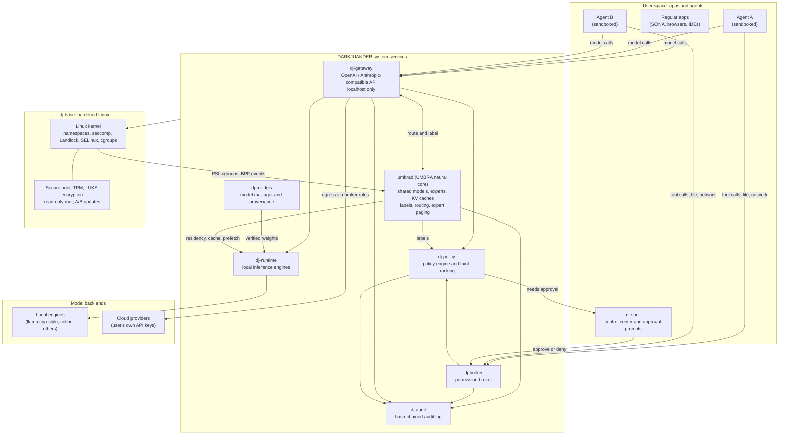
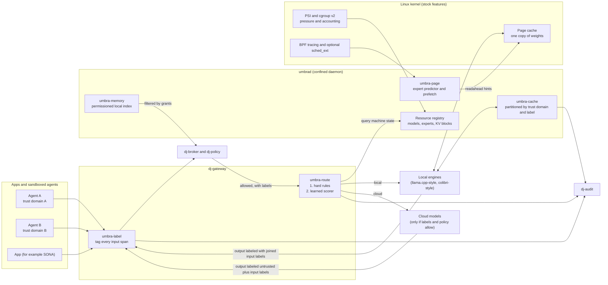

# DARKJUANDER: Product Requirements Document

| Field | Value |
|---|---|
| Product | DARKJUANDER (working name. `branding/research/name-check.md` is a first pass, not clearance. Not a registered trademark.) |
| Owner | Anthony Jaamal Jones ("Jaamal"), Vibe Virtue Enterprise LLC, Valdosta, GA |
| Status | Draft v0.2, for review (v0.2 adds the UMBRA neural core, Section 7) |
| Date | October 27, 2026 |
| Base | Hardened, image-based Linux. No new kernel. |

> **Repository status.** This file is the requirements draft. The code in this
> repository does not implement it. The five demo scenes check specific
> userspace behaviors against a mock engine. They do not prove that a
> compromised agent cannot copy bytes through a side channel, that the disk
> image enforces this threat model, or that any Section 7.9 number has been
> measured. See the README section "What the demos do not prove".

## 1. Summary and vision

DARKJUANDER is a Linux-based desktop and workstation operating system built for running AI models and AI agents safely. AI is part of the operating system's infrastructure, but no single model or vendor is baked in. The user picks which models run, local or cloud, and can swap them at any time without changing the apps that use them.

In his words, Jaamal wants "my own custom operating system designed to be completely flexible with custom AI models as a part of its infrastructure," and it "needs to be Linux base being that it's designed to be for AI Security."

The product rests on three ideas:

1. **One system-wide AI layer.** The OS runs a model service that exposes an OpenAI- and Anthropic-compatible API on localhost. Any app, script, or agent on the machine can call it. Behind that API, the user routes requests to local engines (llama.cpp-style runtimes, or MoE streaming engines such as [colibri](https://github.com/JustVugg/colibri)) or to cloud providers.
2. **Agents are first-class, and they are contained.** Every agent runs in its own sandbox with explicit, revocable permissions, the way Android apps hold permissions. Destructive or outbound actions need user approval. Every action is written to an audit log. Content from the web, email, and files is tagged as untrusted so it cannot quietly take control of an agent.
3. **A neural core that manages AI like memory.** UMBRA (working name, Section 7) treats loaded models, MoE experts, and conversation caches as shared OS resources with owners, budgets, and security labels. It routes each request to the right model based on the task, the data's sensitivity, and live kernel pressure signals, and it carries untrusted-content labels through every model call and cache.

The headline is AI security. Plenty of operating systems are adding AI features. DARKJUANDER's pitch is that you can give an AI system real access to your machine and still know what it can touch, what it did, and how to stop it.

## 2. Problem and why now

### 2.1 The problem

People who run AI agents on their own machines today face a bad trade:

- **Agents get too much access or too little.** A coding agent or automation bot running as your user account can read your SSH keys, browser cookies, and every file you own. The alternative is to hand-build containers and VMs for each agent, which most people will not do.
- **Prompt injection is unsolved at the model level.** A web page, email, or document can carry instructions that an agent follows. The OWASP Top 10 for LLM Applications lists prompt injection as LLM01, the first entry in its 2025 list ([OWASP GenAI](https://genai.owasp.org/llmrisk/llm01-prompt-injection/)). Model vendors cannot fix this alone; the system around the model has to limit what a fooled agent can do.
- **Models change every month.** Tying a workflow to one vendor's assistant means rewriting it when a better or cheaper model ships. Each app also ships its own model client, keys, and settings.
- **There is no shared record.** When several agents act on one machine, there is usually no single place to see what each one read, ran, sent, or deleted.
- **Local models are hard to run well.** Picking quantizations, fitting models into RAM, and keeping engines updated is manual work.

### 2.2 Why now

- Local inference has become practical on consumer hardware. Projects like colibri stream mixture-of-experts weights from disk so very large open models can run on machines with modest RAM; colibri's README lists 8 GB of RAM as a bare minimum and recommends 16 GB or more ([colibri README](https://github.com/JustVugg/colibri)).
- OpenAI-style and Anthropic-style chat APIs have become de facto standards. Many tools already accept a custom base URL, so a local endpoint can serve existing software without code changes.
- Tool protocols such as the Model Context Protocol ([modelcontextprotocol.io](https://modelcontextprotocol.io/)) give agents a common way to call tools, which also gives the OS a common place to enforce policy.
- The Linux kernel now ships sandboxing pieces that an unprivileged process can use, such as Landlock ([kernel docs](https://docs.kernel.org/userspace-api/landlock.html)), alongside namespaces, seccomp, and SELinux/AppArmor.
- Image-based Linux distributions with read-only roots and atomic rollback are mature (for example [Fedora Atomic Desktops](https://docs.fedoraproject.org/en-US/atomic-desktops/) and [bootc](https://bootc-dev.github.io/bootc/)), which makes a verified, immutable base achievable for a small team.

## 3. Target users

Start narrow. The first users are people who already run Linux or are comfortable in a terminal and who run AI tools daily.

| Segment | What they need | Why they might switch |
|---|---|---|
| **Solo founders running agent fleets** (Jaamal is user zero) | Many agents running at once, each with its own keys, files, and limits; a single audit trail; cost control across local and cloud models | Today this takes hand-built containers and scattered logs |
| **Developers** | A local model API that existing tools can point at; safe sandboxes for coding agents | Coding agents with shell access are a real risk on a normal desktop |
| **Creators** (music, video, games) | Local models for creative tools (for example SONA, Jaamal's DAW) without uploading work to the cloud | Privacy and offline work |
| **Privacy-minded users** | No telemetry, local-first defaults, clear control over what leaves the machine | Discomfort with AI features in mainstream OSes |
| **Security researchers and red-teamers** (later) | A platform to test agents and models under controlled policy | Built-in audit and policy tooling |

**Being realistic:** mainstream consumers, enterprises with fleet-management needs, and gamers who depend on anti-cheat software are not v1 targets. Early adoption will likely be in the hundreds or low thousands of technical users, many of whom will first try it in a VM. Plan for that.

## 4. Goals and non-goals

### 4.1 Goals (v1)

1. Ship a hardened, image-based Linux build with atomic A/B updates and rollback.
2. Provide a system AI service with an OpenAI- and Anthropic-compatible API on localhost, routing to local or cloud models chosen by the user.
3. Let users install, verify, swap, and remove models without breaking apps.
4. Run each agent in a sandbox with declared, user-granted permissions.
5. Require user approval for destructive and outbound agent actions, by policy.
6. Record every agent action in a tamper-evident local audit log.
7. Ship with no telemetry, and make every network egress by the AI layer visible.
8. Run well as a VM image first, then on real hardware through an installer.
9. Ship the UMBRA neural core (Section 7) with shared model residency, label-aware caching and routing, and pressure-aware fallback, all demoable in a VM.

### 4.2 Non-goals (v1)

- **No new kernel.** DARKJUANDER uses the upstream Linux kernel with hardening options. A from-scratch kernel would cost years and lose Linux's drivers, fast security patches, and decades of review.
- **Not a phone or tablet OS.** Mobile is out of scope for v1.
- **No proprietary in-house foundation model.** DARKJUANDER hosts models; it does not train frontier models.
- **No verified microkernel in the MVP.** seL4-style isolation is a later phase (Section 11).
- **Not a Windows or macOS app compatibility layer.** Standard Linux tooling (Flatpak, containers, Wine/Proton) works as it does elsewhere, but DARKJUANDER will not build its own.
- **No enterprise fleet management in v1** (MDM, central policy servers).
- **No always-on screen recording or "remember everything" feature.** Any such feature is opt-in and out of scope for v1.

## 5. Competitive landscape

Only well-documented facts are listed. No market sizes are given.

| Product | What it does with AI in the OS | Relevance to DARKJUANDER |
|---|---|---|
| **Windows 11 Copilot+ PCs** (Microsoft) | A hardware class with a 40+ TOPS NPU, at least 16 GB RAM and 256 GB storage, required for features like Recall and Click to Do ([Microsoft specs](https://www.microsoft.com/en-us/windows/windows-11-specifications)). Recall was reworked after security criticism to be opt-in, with processing in a VBS enclave and keys protected by the TPM ([Windows blog, Sept 2024](https://blogs.windows.com/windowsexperience/2024/09/27/update-on-recall-security-and-privacy-architecture/)). | Biggest distribution. Shows that OS-level AI draws security scrutiny, and that enclave isolation is becoming expected. Tied to Microsoft's models and accounts. |
| **Apple Intelligence** (Apple) | On-device models plus Private Cloud Compute for larger requests, running on Apple silicon servers with attestation and a published security guide for researchers ([Apple Security Research](https://security.apple.com/blog/private-cloud-compute/)). | Strongest privacy story among the big players. Closed ecosystem, Apple's models and partners only, Apple hardware only. |
| **Android with Gemini Nano** (Google) | Gemini Nano runs in the AICore system service. AICore is isolated from most packages and has no direct internet access; downloads go through Private Compute Services ([Android Developers](https://developer.android.com/ai/gemini-nano)). | Closest analog to "AI as a system service with isolation." Mobile only, Google's model. |
| **Ordinary Linux distros plus local model tools** (Ubuntu, Fedora, Arch with llama.cpp, Ollama, LM Studio, colibri) | Users can already run local models and OpenAI-compatible servers. | The real "competitor" for early users: they can assemble this themselves. DARKJUANDER must save meaningful time and add security they would not build alone. |
| **Security-focused OSes** (Qubes OS, Tails, GrapheneOS) | Strong isolation (Qubes uses VMs per domain), amnesic or hardened designs. No AI layer. | Show that a security-first audience exists and accepts some friction. Qubes is a design reference for the later isolation phase. |

**Where DARKJUANDER fits:** it is the only option in this list that combines (a) any model, local or cloud, behind one system API, (b) per-agent sandboxing and permission brokering as an OS feature, and (c) an open, inspectable Linux base. The big vendors will keep improving; DARKJUANDER should not try to beat them on polish. It should win on openness, model choice, and agent containment.

## 6. Architecture overview

### 6.1 Base distribution options

| Option | Strengths | Weaknesses |
|---|---|---|
| **Fedora Atomic / Fedora bootc (image mode)** | Read-only root, atomic updates and rollback; OS images built from a Containerfile with normal container tooling ([bootc](https://bootc-dev.github.io/bootc/)); SELinux enforcing by default; recent kernels; x86_64 and aarch64 builds; downstream projects (for example Universal Blue) already build custom images this way | Fast release cadence (about every six months) means regular rebases; bootc on desktops is newer than rpm-ostree |
| **Debian stable plus a custom image pipeline** (mkosi, systemd-repart, A/B partitions) | Very stable, long support, huge package archive | Image-based and atomic update tooling must be assembled by hand; AppArmor by default, SELinux is less integrated; older kernels |
| **NixOS-style declarative system** | Fully reproducible builds; rollbacks built in; whole system described in code | Steep learning curve for users and contributors; non-standard filesystem layout breaks some software; secure boot and immutable-root setups need extra work |
| **Build from scratch** (Yocto, Buildroot, or similar) | Smallest attack surface, full control | Large ongoing maintenance load for a solo founder; poor desktop app support |

**Recommendation: build on Fedora bootc (image mode), starting from a Fedora Atomic desktop base.** It gives a read-only root, A/B-style atomic updates with rollback, and SELinux out of the box, and the whole OS is defined in a Containerfile that one person can maintain in Git and build in CI. Keep the DARKJUANDER components (AI service, broker, policy engine, audit log) distro-neutral, packaged as system services and OCI images, so a move to Debian or another base stays possible.

**Note on Jaamal's Mac (M1 Max, 64 GB):** Apple silicon has no TPM and does not support the standard UEFI Secure Boot chain. For the MVP, run DARKJUANDER as an aarch64 VM on the Mac (for example with UTM or another hypervisor built on Apple's Virtualization framework). Fedora Asahi Remix runs on M1 Max hardware, but some features are still missing on that chip, such as USB-C/Thunderbolt external displays ([Asahi Linux M1 feature support](https://asahilinux.org/docs/platform/feature-support/m1/)). Treat bare-metal Mac support as a stretch goal, and make x86_64 PCs with TPM 2.0 the main bare-metal target.

### 6.2 Components

| Component | Working name | Role |
|---|---|---|
| Hardened base image | `dj-base` | Read-only root, signed images, A/B updates, secure boot, TPM-bound full-disk encryption |
| AI runtime service | `dj-runtime` | Runs local inference engines as sandboxed services; schedules RAM/GPU; loads and unloads models |
| Model manager | `dj-models` | Installs, verifies, versions, and removes models; tracks provenance and licenses |
| System AI API | `dj-gateway` | OpenAI- and Anthropic-compatible API on localhost; routes requests to local engines or cloud providers through `umbra-route`; holds cloud API keys so apps never see them |
| Neural core | `umbrad` (UMBRA) | Manages models, experts, and KV caches as labeled, shared, accounted resources; label propagation; expert paging; personal memory index (Section 7) |
| Agent sandbox | `dj-sandbox` | Launches each agent in its own confined environment (namespaces, seccomp, Landlock, SELinux label, cgroup limits) |
| Permission broker | `dj-broker` | Holds each agent's granted capabilities; mediates access to files, network, devices, secrets, and other agents; raises approval prompts |
| Policy engine | `dj-policy` | Evaluates every tool call and outbound action against rules; applies untrusted-content taint rules |
| Audit log | `dj-audit` | Append-only, hash-chained record of agent actions, approvals, model calls, and policy decisions |
| UI shell | `dj-shell` | Desktop environment plus a control center for models, agents, permissions, approvals, and audit |
| Update service | `dj-update` | Pulls signed OS images, stages them in the inactive slot, and rolls back on failed boot |

### 6.3 Architecture diagram



### 6.4 How a typical agent action flows

1. An agent asks the gateway for a model completion. UMBRA labels each part of the input (trusted or untrusted, public or private). The gateway checks that the agent is allowed to use that model and budget, and UMBRA's router picks a local engine or a cloud provider within the limits set by the labels, the policy, and current machine pressure.
2. The model replies with a tool call, for example "send email" or "delete folder." The reply carries the combined labels of everything that produced it.
3. The agent passes the tool call to the broker. The broker asks the policy engine for a decision: allow, deny, or ask the user.
4. If the context that produced the call includes untrusted content (a web page, an inbound email), the policy engine raises the bar: outbound or destructive actions always go to the user.
5. The user sees a plain description of the action in the shell and approves or denies it.
6. The broker carries out the action within the agent's granted scope. Every step is written to the audit log.

## 7. Neural core: UMBRA (working name)

**UMBRA** stands for *Unified Model, Buffer and Routing Architecture*. It is a working name, chosen to fit the DARKJUANDER "dark" theme, and it needs the same trademark check as the OS name.

### 7.1 What it is, in plain English

UMBRA is the part of DARKJUANDER that manages AI the way an operating system manages memory and processes. Loaded models, MoE experts, and conversation caches become shared system resources with owners, security labels, and budgets, and every app and agent on the machine draws on the same pool. A routing layer then decides which model or expert handles each request based on what the request is, how sensitive its data is, and how much RAM, disk bandwidth, and battery the machine has right now. Security labels travel with the data through every model call, so the OS always knows when untrusted content has touched an answer.

### 7.2 What already exists

Most of the individual ideas in UMBRA have been published or shipped somewhere. UMBRA should not be described as "never seen before." The honest claim is narrower (Section 7.3).

| Idea | Existing work | What it does | What it does not do |
|---|---|---|---|
| OS-style paging for the KV cache | vLLM PagedAttention ([Kwon et al., SOSP 2023](https://arxiv.org/abs/2309.06180)) | Stores KV caches in fixed-size blocks like virtual-memory pages, with sharing and copy-on-write between requests | Runs inside one serving process; it has no notion of OS users, agents, or security labels |
| Prefix cache reuse | SGLang RadixAttention ([Zheng et al., NeurIPS 2024](https://arxiv.org/abs/2312.07104)); llama.cpp server slot save/restore ([llama.cpp server docs](https://github.com/ggml-org/llama.cpp/blob/master/tools/server/README.md)) | Reuses cached computation when prompts share a prefix | Cache sharing ignores who sent the prompt. Shared prompt caches can leak other users' prompts through timing ([Gu et al., 2025](https://arxiv.org/abs/2502.07776)) |
| Learned model routing | RouteLLM ([Ong et al., ICLR 2025](https://arxiv.org/abs/2406.18665)) | Learns to send easy queries to a cheap model and hard ones to a strong model | Optimizes cost and quality only; no privacy labels, no machine pressure signals |
| Combining several models | Mixture-of-Agents ([Wang et al., 2024](https://arxiv.org/abs/2406.04692)) | Layers of models refine each other's answers | An application-level technique, not a resource manager |
| MoE expert offloading and prefetch | MoE-Infinity ([Xue et al.](https://arxiv.org/abs/2401.14361)); colibri streams experts from disk ([colibri](https://github.com/JustVugg/colibri)) | Predicts which experts will be needed and keeps hot ones in memory | Lives inside one engine; does not use kernel pressure signals or share the expert cache across engines |
| Speculative decoding | [Leviathan et al., ICML 2023](https://arxiv.org/abs/2211.17192); supported in llama.cpp ([docs](https://github.com/ggml-org/llama.cpp/blob/master/docs/speculative.md)) | A small draft model proposes tokens that the large model checks | A per-engine speed trick |
| Taint tracking for prompt injection | CaMeL ([Debenedetti et al., 2025](https://arxiv.org/abs/2503.18813)); Microsoft FIDES ([Costa et al., 2025](https://arxiv.org/abs/2505.23643), [Agent Framework docs](https://learn.microsoft.com/en-us/agent-framework/agents/security)) | Attach integrity and confidentiality labels to data and block unsafe flows into tool calls | Enforced inside one agent framework; apps outside the framework are not covered, and model caches and routing are not label-aware |
| An "agent operating system" | AIOS ([Mei et al., COLM 2025](https://arxiv.org/abs/2403.16971)) | An agent kernel layer that schedules agents and manages context, memory, tools, and access control | A Python framework that runs on top of an ordinary OS; it does not use Linux kernel signals or OS-level isolation |
| AI as a system service | Android AICore ([docs](https://developer.android.com/ai/gemini-nano)); Apple Foundation Models framework ([Apple](https://developer.apple.com/foundation-models-framework/)); Microsoft Foundry on Windows ([Microsoft Learn](https://learn.microsoft.com/en-us/windows/ai/overview)) | One OS-provided model that apps share, with privacy isolation | Vendor-chosen models; developers cannot add their own scheduler or routing policy at the OS layer |
| Kernel hooks UMBRA builds on | sched_ext ([kernel docs](https://docs.kernel.org/scheduler/sched-ext.html)); PSI ([kernel docs](https://docs.kernel.org/accounting/psi.html)) | BPF-defined CPU schedulers (upstream since Linux 6.12); pressure stall metrics for CPU, memory, and I/O | General tools with no knowledge of AI workloads |

### 7.3 Why UMBRA is different

A quick search did not turn up a shipping operating system that combines the following. That is the result of a short search, not proof that no one has done it.

1. **Security labels are part of the resource.** A KV-cache block, a retrieved memory chunk, or a model output carries labels for integrity (trusted or untrusted), confidentiality (public, private, secret), origin, and owning agent. A cached prefix can only be reused by a request in the same trust domain with compatible labels. This turns prompt caching from a cross-user timing side channel into a controlled resource, and it stops a tainted prefix from quietly feeding a "trusted" context. CaMeL and FIDES track labels inside one agent framework. UMBRA enforces them at the OS level for every app and also applies them to caches, routing, and memory.
2. **The router is driven by policy and by the kernel.** Routing first applies hard rules that it cannot override: privacy labels, the user's local-only setting, and the broker's permissions. Only then does a small learned scorer rank the remaining options, using signals the OS already has: PSI memory and I/O pressure, free RAM, battery state, which models and experts are already warm, and how much of the prompt is already cached. RouteLLM-style routers look at the prompt; they do not see the machine.
3. **One expert and weight cache for the whole machine.** Model weights are mapped read-only from verified files, so the kernel page cache holds one copy no matter how many apps or agents use the model. An expert pager predicts upcoming MoE experts and asks the kernel to read them ahead, and it backs off when PSI shows the machine is under memory or I/O pressure.
4. **Per-agent accounting with normal Linux tools.** Each agent's inference work is charged to that agent's cgroup, so fair-share CPU time, memory limits, and I/O weights apply to AI work the same way they apply to any process, and the user can see per-agent AI usage in one place.
5. **Model-agnostic.** All of the above works with local engines (llama.cpp-style, colibri-style) and cloud APIs, and nothing is tied to one vendor's model.

### 7.4 Components

| Component | Name | Where it runs | Role |
|---|---|---|---|
| Neural resource manager | `umbrad` | Userspace system daemon (confined, own SELinux domain) | Registry of models, experts, KV blocks, adapters, and embeddings as named resources with owner, labels, reference counts, and cgroup charging. Single control point; all other UMBRA parts are its modules. |
| Label service | `umbra-label` | In the `dj-gateway` request path (a library shared with `umbrad`) | Attaches labels to every span of input, propagates them to outputs and caches, and passes them to `dj-policy`. |
| Label-aware cache | `umbra-cache` | Inside the engine process, managed by `umbrad` | Prefix/KV cache partitioned by trust domain and label set; eviction driven by memory pressure. |
| Router | `umbra-route` | Inside `dj-gateway` | Constraint filter, then learned scorer, then a decision with a logged reason. |
| Expert and weight pager | `umbra-page` | Userspace thread in `umbrad`, plus an engine adapter | Predicts experts, issues readahead, pins hot experts, and backs off under pressure. |
| Pressure and trace probes | `umbra-probe` | Kernel: PSI triggers, cgroup v2 files, BPF tracing programs. Userspace: reader in `umbrad`. | Supplies live machine signals to the router and pager. |
| AI-aware CPU scheduler | `scx_umbra` | Kernel, as a sched_ext BPF scheduler (optional) | Keeps the UI responsive while inference and prefetch run; groups by layer: UI, foreground inference, background agents, prefetch I/O. |
| Personal memory index | `umbra-memory` | Userspace service, encrypted store | Opt-in local embedding index of user-chosen folders. Every chunk keeps its file path, permission, and labels. Retrieval is filtered by the broker before search results return. |
| Inspector | `umbra top` / control-center page | Userspace CLI and UI | Shows resident models, cache use per agent, routing decisions, and label chains. |

### 7.5 Kernel versus userspace

The rule is simple: **no neural network runs in the kernel, and UMBRA adds no custom kernel modules.** The kernel supplies signals, accounting, isolation, and scheduling hooks through upstream features. All inference, learning, and labeling happen in confined userspace processes.

| Layer | What UMBRA uses | Priority |
|---|---|---|
| Kernel, stock features | File-backed read-only `mmap` so one copy of each model's weights sits in the page cache; `madvise(MADV_WILLNEED)`, `posix_fadvise`, and `readahead` for expert prefetch; `mlock` for pinned hot experts within a set budget; io_uring for batched expert reads; cgroup v2 controllers (cpu, memory, io, pids) for per-agent and per-engine accounting; PSI triggers on `/proc/pressure/*` and per-cgroup pressure files | P0 (PSI, cgroups, mmap) / P1 (prefetch, mlock, io_uring) |
| Kernel, through BPF loaded by `umbrad` | Tracing programs on block I/O and page-cache tracepoints to measure expert-file misses and read latency (exact hooks chosen during the Phase 1 spike), sending events over a BPF ring buffer; optional `scx_umbra` sched_ext scheduler, likely built from the `scx_layered` design in [sched-ext/scx](https://github.com/sched-ext/scx) | P1 (tracing) / P2 (sched_ext) |
| Kernel, security features | SELinux and Landlock rules so only engine processes can read model files and only `umbrad` can load UMBRA's BPF programs; unprivileged BPF stays disabled (BASE-5) | P0 |
| Userspace | `umbrad`, router, label service, cache manager, pager, memory index, engine adapters, inspector, all written in a memory-safe language (Rust recommended) | P0 to P2 by component |

Notes:
- PSI and cgroup v2 need no BPF at all, so the MVP does not depend on BPF working in the VM.
- sched_ext needs a kernel built with `CONFIG_SCHED_CLASS_EXT` (Linux 6.12 or later). Confirm the Fedora kernel config during Phase 0. If the BPF scheduler errors or stalls, the kernel switches back to the default scheduler on its own ([kernel docs](https://docs.kernel.org/scheduler/sched-ext.html)), which limits the damage a buggy scheduler can do.
- Page-cache sharing only saves memory when engines map the same file. Engines that copy weights into private memory (some GPU back ends) do not benefit. In that case UMBRA shares one engine process with several slots instead.
- Cache charging: the page cache charges a page to the cgroup that first touched it. UMBRA places model weights in a dedicated `umbra-weights.slice` so one agent is not billed for a model every agent uses.

### 7.6 Data flow



Label rules:
- An output's labels are the *join* of the labels of everything that produced it: inputs, retrieved memory, cached prefix, and tool results. Untrusted in means untrusted out.
- Labels are never lowered automatically. Only the user can declassify data, through a broker prompt, and every declassification is written to the audit log.
- A request labeled `private` or `secret` cannot be routed to a cloud model unless the user's policy names that provider as allowed for that label.
- A cached prefix is reused only when the trust domain matches and the cached labels are no more permissive than the new request allows.

### 7.7 Requirements

| ID | Requirement | Priority |
|---|---|---|
| UM-1 | `umbrad` keeps a registry of loaded models and their resident memory, owners (callers), and reference counts, exposed through `umbra top` and the control center | P0 |
| UM-2 | One resident copy of a model's weights serves every caller using that model (one shared engine process with slots, or shared read-only `mmap`) | P0 |
| UM-3 | Every input span carries labels for integrity, confidentiality, origin, and owner; outputs carry the join of their input labels | P0 |
| UM-4 | Labels are passed with every tool call to `dj-policy` and written to `dj-audit` | P0 |
| UM-5 | Prefix/KV cache entries are keyed by model, prefix hash, trust domain, and label set; reuse across trust domains is impossible by construction | P0 |
| UM-6 | Router applies hard rules first (labels, local-only mode, broker permissions, spend limits) and logs a human-readable reason for every decision | P0 |
| UM-7 | Router reads PSI memory and I/O pressure and free RAM, and falls back to a smaller local model (or an allowed cloud model) when thresholds are crossed | P0 |
| UM-8 | Inference work is charged to the calling agent's cgroup for CPU accounting; weights live in a shared `umbra-weights.slice` | P0 |
| UM-9 | No inference code runs in the kernel; no custom kernel modules | P0 |
| UM-10 | Learned scorer ranks allowed routes using prompt features and machine state; trained only on local signals (latency, retries, explicit user ratings); never sends data off the machine | P1 |
| UM-11 | Expert pager for MoE engines: engine adapter reports per-layer expert selections; predictor issues readahead and pins hot experts within a memory budget; backs off under PSI pressure | P1 |
| UM-12 | BPF tracing probes measure expert-file page-cache misses and I/O latency and feed the pager | P1 |
| UM-13 | `umbra-memory`: opt-in per folder, encrypted at rest, chunks keep source path and labels; retrieval filtered by the caller's broker grants before results return | P1 |
| UM-14 | Speculative decoding managed system-wide: one small draft model shared across compatible target models | P1 |
| UM-15 | Cache and route decisions visible per agent in the control center, including label chains for any answer | P1 |
| UM-16 | `scx_umbra` sched_ext scheduler keeps UI latency low during heavy inference; off by default until benchmarks show a benefit | P2 |
| UM-17 | Ensemble mode (Mixture-of-Agents style) as a router option for high-value requests, with cost and label limits | P2 |
| UM-18 | Low-rank adapters (LoRA) treated as shareable resources that can be hot-swapped onto a resident base model per caller | P2 |
| UM-19 | Optional timing-noise or padding mode for cache hits inside a trust domain, for users who need extra side-channel protection | P2 |

### 7.8 MVP demo in a VM (M1 Max, 64 GB)

Setup: DARKJUANDER aarch64 VM under UTM on the Mac with about 32 GB of RAM and 8 vCPUs given to the guest. Inference runs on CPU in the guest; plan for no GPU acceleration inside the VM. Use one small dense model (about 3 to 4B parameters) and one mid-size model (about 7 to 14B), both quantized GGUF, behind one alias.

The demo has five short scenes, each shown in `umbra top` and the audit log:

1. **One copy, many callers.** Three sandboxed agents and one app call `default-chat` at the same time. `umbra top` shows one resident copy of the weights. Baseline for comparison: three separate llama-server processes, each loading its own copy.
2. **Cache sharing that respects trust domains.** Two requests from Agent A share a long system prompt; the second one's time to first token drops because the prefix is cached. Agent B sends the same prefix and gets no cache hit, so its timing reveals nothing about Agent A.
3. **Taint follows the data.** A research agent reads a test web page containing a hidden instruction to email a file. The model's output is labeled `untrusted`. When the agent tries `email.send`, policy forces an approval prompt, and the audit log shows the chain: web page, model call, tool call, prompt, denial.
4. **The router reacts to the machine.** Start a memory hog (for example `stress-ng --vm`). PSI memory pressure rises, the router moves new requests from the mid-size model to the small one, and the audit log records the reason ("PSI memory some avg10 above threshold").
5. **Labels block the cloud.** In local-plus-cloud mode, a request that includes a `private` file is kept local even though the router's scorer would have preferred the cloud model, and the log says why.

Stretch for the end of Phase 1: run a small MoE model (for example OLMoE, which colibri supports) and show tokens per second with the expert pager on versus off.

### 7.9 Targets

All numbers below are **targets** for the VM demo setup above. None are measurements.

| Measure | Target |
|---|---|
| Resident weight memory with 4 callers on one model | No more than 1.1 times the memory of a single caller (excluding per-request KV cache) |
| Time to first token on a cached 2,000-token shared prefix, same trust domain | At least 50% lower than with no cache |
| Cache hits across trust domains | Zero, in every test |
| Label propagation | 100% of outputs in the test suite carry the join of their input labels; zero automatic downgrades |
| Router overhead | Under 5 ms at the 95th percentile, not counting model time |
| Reaction to memory pressure | Routing changes within 2 seconds of a PSI threshold crossing |
| Expert pager (Phase 1 stretch, MoE on disk) | At least 20% more tokens per second than with prefetch off, on the same VM |
| Desktop responsiveness during inference (P2, `scx_umbra`) | Measurable drop in UI frame-time spikes compared with the default scheduler; exact threshold set after a baseline run |

### 7.10 Risks specific to UMBRA

| Risk | Response |
|---|---|
| `umbrad` becomes a high-value target because it sees every request | Own SELinux domain, no network access, memory-safe language, fuzzing of its request parser, outside review before Phase 1 exits |
| Shared caches create side channels | Partition by trust domain by default (UM-5); optional timing padding (UM-19) |
| Router poisoning: crafted content steers requests to a cloud model to leak data | Hard rules run before the learned scorer and cannot be overridden by it; labels travel with the request |
| Label laundering: an agent summarizes untrusted text so it looks clean | Join rule on outputs; only the user can declassify, and declassification is logged |
| Memory index leaks files an agent should not see | Broker filters before retrieval, not after; per-folder opt-in; chunks keep file permissions |
| BPF programs are privileged code | Only `umbrad` loads them; programs are signed and verified at build time; unprivileged BPF disabled; sched_ext falls back on error |
| Label-heavy design annoys users with prompts | Default rules ask only for outbound and destructive actions, matching PB-4 |

### 7.11 What could make this not work

Several things could limit UMBRA, and Jaamal should know them before committing build time. On a single-user machine, much of the "shared resource" benefit comes from running one engine server for everything, which tools like Ollama and llama-server already do, so the measurable gain over that baseline may be modest. Engines such as llama.cpp and colibri do not expose per-layer expert selections or label-aware caches out of the box, so UMBRA will need adapter patches or forks that must be kept in sync with fast-moving upstream code. A learned router needs feedback data, and one user produces little of it; for a long time, hand-written rules may beat the learned scorer. Expert prediction accuracy varies by model, and a VM on a Mac adds a virtual disk layer that may hide or erase prefetch gains. sched_ext may show no benefit for this workload, which is why it is P2 and off by default. Finally, labels only help if every path into a model goes through the gateway; an app that bundles its own model and ignores the system API is outside UMBRA's view, though the sandbox still limits what that app can reach. The parts least likely to fail are the security parts, trust-domain cache partitioning and label propagation, because they are mostly careful bookkeeping and do not depend on performance tricks paying off.

### 7.12 Suggested repository layout

For the GitHub repository Jaamal plans to create:

```
darkjuander/
  image/            Containerfile (bootc), kernel config fragments, SELinux policy
  services/
    gateway/        dj-gateway + umbra-route
    umbrad/         resource registry, umbra-label, umbra-cache, umbra-page, umbra-memory
    broker/         dj-broker
    policy/         dj-policy and default rules
    audit/          dj-audit
  bpf/              umbra-probe tracing programs, scx_umbra (later)
  engines/          adapters and patches for llama.cpp-style and colibri-style engines
  shell/            control center UI and the dj CLI
  tests/
    injection/      prompt-injection and label-propagation test pages
    bench/          VM benchmark scripts for the Section 7.9 targets
  docs/             this PRD, threat model, ADRs
```

## 8. Detailed requirements

Priority key: **P0** = required for MVP; **P1** = required for the first installable release; **P2** = later.

UMBRA neural core requirements (UM-1 to UM-19) are in Section 7.7.

### 8.1 Hardened base image (`dj-base`)

| ID | Requirement | Priority |
|---|---|---|
| BASE-1 | Built as a bootc/OCI image from a Containerfile kept in Git; reproducible CI build | P0 |
| BASE-2 | Read-only root filesystem; writable state only in `/etc`, `/var`, and home | P0 |
| BASE-3 | Atomic A/B updates with automatic rollback if the new image fails to boot | P0 |
| BASE-4 | OS images signed; update service refuses unsigned or mismatched images | P0 |
| BASE-5 | SELinux enforcing; kernel hardening options (lockdown mode, restricted unprivileged BPF, restricted kernel pointer and dmesg access, module signing) | P0 |
| BASE-6 | Minimal default package set; no services listening on non-localhost interfaces by default | P0 |
| BASE-7 | Firewall default deny inbound | P0 |
| BASE-8 | No telemetry, crash upload, or "phone home" by default; any opt-in reporting is off unless the user turns it on | P0 |
| BASE-9 | Ships as VM images for x86_64 and aarch64 (QCOW2 and raw) | P0 |
| BASE-10 | UEFI Secure Boot with DARKJUANDER-signed shim/bootloader, or measured boot with documented key enrollment | P1 |
| BASE-11 | Full-disk encryption (LUKS2) with keys sealed to TPM 2.0 plus a PIN or passphrase | P1 |
| BASE-12 | Graphical installer for bare metal | P1 |
| BASE-13 | Hardened memory allocator and other userspace hardening, evaluated for app compatibility | P2 |

### 8.2 AI runtime service (`dj-runtime`)

| ID | Requirement | Priority |
|---|---|---|
| RT-1 | Runs at least one llama.cpp-style engine for GGUF models on CPU and GPU | P0 |
| RT-2 | Each engine runs as its own confined service with no network access and read-only access to its model files | P0 |
| RT-3 | Pluggable engine interface so new engines (for example colibri for disk-streamed MoE models) can be added without changing the gateway | P0 |
| RT-4 | RAM and VRAM accounting; refuses to load a model that would push the system into swap thrashing, and explains why | P0 |
| RT-5 | Load models on demand and unload idle models after a configurable timeout | P1 |
| RT-6 | GPU support: NVIDIA (CUDA), AMD (ROCm/Vulkan), and Vulkan as a general fallback | P1 |
| RT-7 | Concurrent requests from multiple agents with per-agent fair scheduling | P1 |
| RT-8 | NPU support where Linux drivers exist | P2 |
| RT-9 | Embeddings, speech-to-text, and text-to-speech engines under the same runtime | P2 |

### 8.3 Model manager (`dj-models`)

| ID | Requirement | Priority |
|---|---|---|
| MM-1 | Install models from a URL or local file; record source, hash (SHA-256), size, format, and license | P0 |
| MM-2 | Verify hashes on install and before each load | P0 |
| MM-3 | Prefer safe weight formats (GGUF, safetensors); refuse pickle-based formats unless the user explicitly overrides | P0 |
| MM-4 | List, remove, and pin model versions; rollback to a previous version | P0 |
| MM-5 | Verify publisher signatures when available (for example Sigstore or a DARKJUANDER signing key for curated models) and show provenance in the UI | P1 |
| MM-6 | Curated catalog of tested models with recommended hardware tier | P1 |
| MM-7 | "Fits on this machine" estimate based on RAM, VRAM, and disk | P1 |
| MM-8 | Model behavior test suite (basic prompt-injection and tool-misuse checks) runnable before a model is trusted for agent use | P2 |

### 8.4 System AI API (`dj-gateway`)

| ID | Requirement | Priority |
|---|---|---|
| GW-1 | OpenAI-compatible endpoints for chat completions, streaming, tool calls, and models list on localhost | P0 |
| GW-2 | Anthropic-compatible messages endpoint on localhost | P0 |
| GW-3 | Listens only on localhost or a Unix socket; never on external interfaces unless the user turns on LAN sharing | P0 |
| GW-4 | Per-caller identity: each app or agent gets its own token; requests are tied to that identity in the audit log | P0 |
| GW-5 | Routing rules: map a model alias (for example `default-coder`) to a local or cloud model, so apps keep working when the model behind the alias changes | P0 |
| GW-6 | Cloud provider keys stored in the system keyring and held by the gateway; apps and agents never receive raw keys | P0 |
| GW-7 | Per-caller quotas and spend limits for cloud models | P1 |
| GW-8 | "Local only" mode that blocks all cloud routing system-wide | P0 |
| GW-9 | Fallback chains (for example local first, cloud if the local model is unavailable), each step logged | P1 |
| GW-10 | MCP-compatible tool registry so agents discover tools through the broker | P1 |
| GW-11 | Optional LAN serving to the user's other machines with mutual TLS | P2 |

### 8.5 Agent sandbox (`dj-sandbox`)

| ID | Requirement | Priority |
|---|---|---|
| SB-1 | Each agent runs in its own user, mount, PID, IPC, and network namespaces | P0 |
| SB-2 | seccomp filter per agent profile; default profile blocks dangerous syscalls (kernel module loading, ptrace of other processes, raw sockets) | P0 |
| SB-3 | Landlock rules restrict file access to the agent's own workspace plus any paths granted by the broker | P0 |
| SB-4 | Each agent gets its own SELinux context so policy can tell agents apart | P0 |
| SB-5 | cgroup limits for CPU, memory, disk I/O, and process count | P0 |
| SB-6 | No network by default; network access only through a broker-controlled proxy with per-domain allow lists | P0 |
| SB-7 | Agent manifest (declared name, publisher, requested capabilities, version) required to launch | P0 |
| SB-8 | Kill switch: one action in the shell stops one agent or all agents immediately | P0 |
| SB-9 | Optional stronger isolation: run an agent in a lightweight VM (for example Kata Containers or Firecracker-style microVM) | P1 |
| SB-10 | Snapshot and restore an agent's workspace so the user can undo its file changes | P1 |
| SB-11 | Signed agent packages from a DARKJUANDER agent registry | P2 |

### 8.6 Permission broker (`dj-broker`)

| ID | Requirement | Priority |
|---|---|---|
| PB-1 | Capability model with named permissions, for example `files.read:<path>`, `files.write:<path>`, `net.http:<domain>`, `email.send`, `shell.exec`, `secrets.read:<name>`, `agent.message:<agent>`, `model.use:<alias>` | P0 |
| PB-2 | Permissions granted at install or first use, shown in plain language; user can grant once, for a session, or permanently | P0 |
| PB-3 | User can view and revoke any agent's permissions at any time; revocation takes effect immediately | P0 |
| PB-4 | Approval prompts for actions marked destructive or outbound (delete, overwrite, send, post, pay, install, change system settings) | P0 |
| PB-5 | Approval prompts show the exact action and target (recipient, path, amount, URL), not a summary written by the agent | P0 |
| PB-6 | Approval prompts cannot be drawn or clicked by agents (shown by a trusted shell process, not through the agent's display) | P0 |
| PB-7 | Secrets vault: agents receive scoped, short-lived tokens or have the broker perform the call, rather than getting raw credentials | P1 |
| PB-8 | Agent-to-agent messaging only through the broker, with permissions on both sides | P1 |
| PB-9 | Rate limits on approval prompts to reduce "approval fatigue" attacks; batch similar low-risk approvals | P1 |
| PB-10 | Per-agent capability templates (for example "coding agent," "research agent," "email assistant") | P1 |

### 8.7 Policy engine (`dj-policy`)

| ID | Requirement | Priority |
|---|---|---|
| PE-1 | Evaluates every tool call before execution: allow, deny, or require approval | P0 |
| PE-2 | Untrusted content tagging: data from web pages, inbound email, downloaded files, and other agents is labeled untrusted when it enters an agent's context | P0 |
| PE-3 | Taint rule: if untrusted content is in the context, outbound and destructive actions require user approval regardless of the agent's standing grants | P0 |
| PE-4 | Rules written in a readable policy file (declarative format such as YAML, Rego, or Cedar), versioned, and shown in the UI | P0 |
| PE-5 | Default policy set shipped and documented; user can tighten it, and loosening it shows a warning | P0 |
| PE-6 | Data-exfiltration checks: flag outbound requests that contain secrets, keys, or large chunks of private files | P1 |
| PE-7 | Optional classifier step (a small local model) to flag likely injected instructions; advisory only, never the sole defense | P1 |
| PE-8 | Policy dry-run mode to test rules against recorded audit logs | P2 |

### 8.8 Audit log (`dj-audit`)

| ID | Requirement | Priority |
|---|---|---|
| AU-1 | Records every model call (caller, model, route local/cloud, token counts), tool call, policy decision, approval, denial, and permission change | P0 |
| AU-2 | Append-only, hash-chained entries so edits or deletions are detectable | P0 |
| AU-3 | Stored locally, encrypted at rest; never uploaded by default | P0 |
| AU-4 | Agents cannot read or write the audit log unless granted a read-only audit permission | P0 |
| AU-5 | Search and filter in the UI by agent, time, action type, and outcome | P1 |
| AU-6 | Configurable retention; option to store prompt and response bodies or only metadata | P1 |
| AU-7 | Export to JSON Lines and to a remote syslog or SIEM chosen by the user | P2 |
| AU-8 | Periodic signed checkpoints anchored to the TPM | P2 |

### 8.9 UI shell (`dj-shell`)

| ID | Requirement | Priority |
|---|---|---|
| UI-1 | Ships with one standard desktop environment (decision pending, see Open Questions) | P0 |
| UI-2 | Control center with pages for Models, Agents, Permissions, Approvals, Audit, Network egress, and Updates | P0 |
| UI-3 | Trusted approval dialog that is visually distinct and cannot be faked by apps | P0 |
| UI-4 | System-wide indicator when any agent is running, and when any cloud model call is in progress | P0 |
| UI-5 | Command-line tool (`dj`) covering every control-center function | P0 |
| UI-6 | Built-in assistant that uses the system API and holds no extra privileges beyond what the user grants | P1 |
| UI-7 | First-run setup: choose local only vs. local plus cloud, add keys, pick a starter model for the hardware | P1 |
| UI-8 | Custom DARKJUANDER theme and branding | P2 |

### 8.10 Update and recovery (`dj-update`)

| ID | Requirement | Priority |
|---|---|---|
| UP-1 | Signed image updates staged in the inactive slot; switch on reboot | P0 |
| UP-2 | Automatic rollback after a failed boot; manual rollback from the boot menu | P0 |
| UP-3 | Security updates published within a defined window after upstream fixes (target in Section 12) | P1 |
| UP-4 | Model and engine updates separate from OS updates, so the user controls when models change | P1 |
| UP-5 | Recovery image that can reset the OS without touching encrypted user data | P2 |

## 9. Security and threat model

### 9.1 Assets to protect

- User files, credentials, keys, browser sessions, and messages
- Cloud API keys and spending limits
- The integrity of the OS image and the boot chain
- The integrity of models and agents
- The audit log
- The user's attention (approval prompts must stay meaningful)

### 9.2 Trust boundaries

- **Trusted:** kernel, signed base image, `dj-broker`, `dj-policy`, `dj-audit`, `dj-update`, the shell's approval dialog.
- **Partly trusted:** `dj-gateway`, `dj-runtime`, and `umbrad` (they process untrusted model output and run complex inference code, so they are confined). `umbrad` loads UMBRA's BPF programs, so its confinement and code review get extra attention.
- **Untrusted:** model weights and model output, agents, web content, email, downloaded files, and any cloud provider response.

The key design rule: **model output is untrusted input.** A model's reply is treated like data from the internet. It never gains privileges because it came from "the AI."

### 9.3 Attackers and mitigations

| Attacker | Example attack | STRIDE category | Mitigations |
|---|---|---|---|
| **Malicious web content or email** | Hidden text on a page tells a research agent to email the user's files to an outside address | Tampering, Information disclosure, Elevation of privilege | Untrusted content tagging (PE-2); taint rule forcing approval on outbound actions (PE-3); no network by default (SB-6); per-domain allow lists; exfiltration checks (PE-6); approval prompts show the exact recipient and data (PB-5) |
| **Malicious or backdoored model** | Weights trained to emit harmful tool calls on a trigger phrase; a model file crafted to exploit the inference engine | Tampering, Elevation of privilege | Model output treated as untrusted; all tool calls go through the policy engine; safe weight formats only (MM-3); hash and signature checks (MM-2, MM-5); inference engines confined with no network (RT-2); provenance shown to the user |
| **Malicious or compromised agent** | An agent package reads SSH keys, mines crypto, or floods the user with approval prompts until one is clicked | Information disclosure, Denial of service, Spoofing | Namespaces, seccomp, Landlock, SELinux (SB-1 to SB-4); declared manifest (SB-7); cgroup limits (SB-5); prompt rate limits (PB-9); kill switch (SB-8); agents cannot fake approval dialogs (PB-6, UI-3) |
| **Local attacker** | Someone with physical access to a stolen laptop, or malware already running as the user | Information disclosure, Tampering | Full-disk encryption sealed to TPM plus PIN (BASE-11); secure boot (BASE-10); keys held by the gateway and vault, not in files agents can read (GW-6, PB-7); hash-chained audit log (AU-2); read-only root (BASE-2) |
| **Supply-chain attacker** | Compromised upstream package, poisoned model on a hosting site, or tampered DARKJUANDER update | Tampering, Spoofing | Signed OS images (BASE-4); reproducible CI builds (BASE-1); pinned upstream package versions with SBOMs; model hashes and signatures; signed agent registry (SB-11); two-person or hardware-key signing for releases once there is a team |
| **Network attacker** | Intercepts traffic to cloud providers or to the update server | Information disclosure, Tampering | TLS everywhere with certificate pinning for update servers; gateway listens on localhost only (GW-3) |
| **Curious or hostile co-resident agent** | Agent B times its requests to learn whether Agent A recently sent a given prompt (prompt-cache timing side channel); or plants a poisoned prefix in a shared cache | Information disclosure, Tampering | Caches partitioned by trust domain and label set (UM-5); optional timing padding (UM-19); cache events logged |
| **Router manipulation** | Crafted content pushes the learned router to choose a cloud model so private data leaves the machine | Information disclosure | Hard label and policy rules run before the learned scorer and cannot be overridden (UM-6); every routing decision logged with its reason |
| **Label laundering** | An agent rewrites or summarizes untrusted text so it appears trusted | Tampering, Elevation of privilege | Outputs carry the join of input labels (UM-3); only the user can declassify, and it is audited |
| **Over-trusting user** (not malicious, but a real risk) | User clicks "always allow" for everything | Elevation of privilege | Plain-language prompts; warnings when loosening policy (PE-5); scoped grants by default; periodic review reminders |

### 9.4 Known limits

- Prompt injection cannot be fully prevented by any current technique. The design goal is to limit the damage a fooled agent can do, not to promise it will never be fooled.
- Linux sandboxing shares one kernel across all agents. A kernel exploit can escape a namespace sandbox. This is why the later phases add microVM and microkernel isolation.
- Approval prompts only help if users read them. Too many prompts will train users to click through.
- UMBRA's labels only cover model calls that go through the system API. An app that bundles its own model is outside UMBRA's view, though the sandbox still limits it.
- Local models running on CPU may be slow, which pushes users toward cloud models and weakens the privacy story. The UI must be honest about when data leaves the machine.

## 10. Hardware requirements (initial guidance)

These tiers are starting estimates to be validated in testing, not measured results. Model sizes and speeds change quickly.

| Tier | Typical machine | RAM | Storage | What it can do |
|---|---|---|---|---|
| **Cloud-first** | Any 64-bit PC from the last several years, or a VM | 8 GB | 64 GB | Full OS and security features; small local models only; most AI work routed to cloud models |
| **Local starter** | Modern laptop or desktop, integrated or entry GPU | 16 to 32 GB | 256 GB SSD | Small and mid-size local models; disk-streamed MoE models at lower speed |
| **Local power** | High-RAM workstation or Apple silicon in a VM (for example Jaamal's M1 Max, 64 GB) | 64 GB | 1 TB SSD | Larger local models, several agents at once |
| **Fleet / workstation** | Desktop with one or more 16 GB+ GPUs, or 128 GB+ RAM | 128 GB or more | 2 TB+ NVMe | Many concurrent agents on local models, little or no cloud use |

Inside a Linux VM on Apple silicon, plan for CPU-only inference; GPU acceleration in the guest should not be assumed. UMBRA's expert pager benefits most from fast local NVMe on bare metal; a VM's virtual disk may reduce its gains.

Bare-metal security features (secure boot, TPM-sealed encryption) need UEFI firmware and TPM 2.0. Fast NVMe storage matters for engines that stream model weights from disk.

## 11. Phased roadmap

No dates are set; each phase ends when its exit criteria are met.

### Phase 0: Foundations
- Pick the base (recommended: Fedora bootc) and set up the Git repo, CI build, and image signing.
- Write the agent manifest format, capability list, and default policy file.
- Confirm the base kernel config includes PSI, cgroup v2, BPF with BTF, and `CONFIG_SCHED_CLASS_EXT`.
- Create the GitHub repository using the layout in Section 7.12.
- Exit: a signed, bootable image builds in CI and boots in the UTM VM on the M1 Max.

### Phase 1: MVP, a hardened image plus the AI layer, running in a VM
- All P0 requirements.
- Ships as x86_64 and aarch64 VM images. Jaamal runs it daily on the M1 Max in a VM.
- One local engine, cloud routing for at least two providers, OpenAI- and Anthropic-compatible API.
- Sandboxed agents with broker, policy engine, approval prompts, kill switch, and audit log.
- UMBRA P0 (UM-1 to UM-9): shared residency, labels, trust-domain cache partitioning, rule-based router with PSI fallback, cgroup accounting.
- The five-scene UMBRA demo in Section 7.8, with results recorded against the Section 7.9 targets.
- Exit: Jaamal moves at least part of his real agent fleet onto it, and an outside security review of the sandbox and broker finds no critical issues left unfixed.

### Phase 2: Installable release
- UMBRA P1: learned router scorer, expert pager with BPF probes, personal memory index, shared speculative decoding, per-agent cache and route views.
- All P1 requirements: installer, secure boot, TPM-sealed disk encryption, GPU support, secrets vault, microVM option for high-risk agents, curated model catalog, first-run setup.
- Public beta for technical users; bug bounty or coordinated disclosure policy.
- Exit: installs cleanly on a published list of test machines; update and rollback tested across releases.

### Phase 3: Stronger isolation
- Move the AI runtime and high-risk agents into separate compartments under a hypervisor or verified microkernel (for example seL4-based designs, or a Qubes-style VM split), with the broker as the only bridge.
- Investigate confidential computing features where hardware supports them.
- Exit: a design review shows that a full compromise of an agent or inference engine cannot read user data outside its grants, even with a kernel exploit inside the compartment.

### Phase 4: Ecosystem
- UMBRA P2: `scx_umbra` scheduler (if benchmarks justify it), ensemble mode, shared LoRA adapters, timing padding.
- Signed agent registry, SDKs for agent developers, policy-sharing, optional LAN model serving, possible hardware partner editions.

## 12. Success metrics (targets, not data)

Every number below is a **target** to aim for. None is a measurement.

| Area | Target |
|---|---|
| Security | Zero known sandbox escapes unfixed for more than 14 days after report |
| Security | 100% of agent tool calls and model calls appear in the audit log during test runs |
| Security | 100% of outbound and destructive actions from tainted contexts reach an approval prompt in the internal prompt-injection test suite |
| Patching | Critical upstream security fixes shipped in a DARKJUANDER image within 7 days |
| Reliability | 100% of failed updates roll back automatically in update testing |
| Model flexibility | Swapping the model behind an alias requires zero app changes for the reference apps |
| Usability | A new user goes from boot to first local model response in under 15 minutes on a Local starter machine |
| Usability | Median approvals per agent-hour stays low enough that testers do not report click-through fatigue (threshold set after user testing) |
| Privacy | Zero network connections from the OS to DARKJUANDER servers in default "local only" mode, other than user-triggered updates |
| UMBRA | See the UMBRA-specific targets in Section 7.9 |
| Adoption (Phase 2) | A first set of active beta users (target number set by Jaamal) with weekly use, plus a working feedback channel |

## 13. Risks

| Risk | Why it matters | Response |
|---|---|---|
| **Big players already ship AI in the OS** | Microsoft, Apple, and Google have far more resources and distribution | Do not compete on polish. Compete on model choice, openness, and agent containment for users the big vendors do not serve well. |
| **Models change monthly** | Anything tied to one model or format ages fast | Model-agnostic aliases, pluggable engines, open API standards; no hard dependency on any single model. |
| **Local models need a lot of RAM** | Many users' hardware cannot run strong local models | Cloud-first tier; clear "fits on this machine" guidance; support disk-streaming engines; be honest in the UI about trade-offs. |
| **AI with system access is the biggest security risk** | One bad design choice could let an agent do real damage | Least privilege by default, approval gates, audit, outside security reviews before each phase exit, public disclosure policy. |
| **Adoption and app compatibility** | A new OS needs users and working apps | Stay a standard Linux base so Linux apps, Flatpaks, and containers work; ship as a VM image first so trying it costs nothing. |
| **Solo-founder bandwidth** | An OS is a large, never-finished project | Reuse upstream wherever possible; keep DARKJUANDER's own code to the AI layer and security services; automate builds and tests. |
| **Upstream drift** | Fedora, kernel, and engine changes can break things | Pin versions, test in CI, keep components distro-neutral. |
| **Approval fatigue** | Too many prompts make users stop reading them | Good defaults, batching, scoped grants, and measurement in user testing. |
| **UMBRA's performance gains may be small** | Over a single shared engine server, the gains may not justify the work | Ship UMBRA's security features (labels, partitioned caches) first; measure performance features against a plain llama-server baseline before investing further (Section 7.11) |
| **Name and trademark** | A conflict could force a rename after launch | Run a trademark search before any public release. |

## 14. Open questions for Jaamal

1. **Licensing.** Should DARKJUANDER's own components be open source (for example Apache-2.0 or GPL-3.0), source-available, or closed? Open source helps the security story, since people can inspect it, and fits the Linux base. Upstream licenses (GPL for the kernel and many tools) set rules no matter what you choose.
2. **Desktop environment.** GNOME (Fedora Silverblue default), KDE Plasma (Kinoite), COSMIC, or a tiling window manager such as Sway? This affects how the approval dialog and control center are built.
3. **Business model.** Free OS with paid support? Paid "Pro" features (fleet dashboard, managed model catalog)? Hardware bundles? Hosted signing and agent registry for developers?
4. **Hardware partners.** Is a pre-installed DARKJUANDER machine a goal (for example with a Linux laptop or mini-PC maker), or is it install-only for the foreseeable future?
5. **Name and trademark.** Has a trademark search been done for "DARKJUANDER" in the US (USPTO) and other target markets? Is the domain secured? Will the name be filed under Vibe Virtue Enterprise LLC?
6. **Bare-metal Mac support.** Is running natively on Apple silicon (via Asahi) a goal, or is a VM on the Mac good enough while x86_64 PCs are the bare-metal target?
7. **Cloud providers.** Which cloud providers must be supported at MVP? Should the gateway also support any self-hosted OpenAI-compatible server on the LAN?
8. **Your fleet as the test case.** Which of your current agent bots should move first, and what permissions do they actually need?
9. **SONA and your games.** Should SONA and your games integrate with the system AI API from day one as reference apps?
10. **Security review budget.** Is there budget for an outside security audit before the public beta?
11. **UMBRA name.** Keep "UMBRA" as the neural core's name, or pick another? It needs the same trademark check as DARKJUANDER.
12. **Which engines first?** Should UMBRA's first engine adapter target llama.cpp (larger community, easier to patch) or colibri (disk-streamed MoE, closer to the expert-pager idea)?
13. **Personal memory scope.** Which folders, if any, should `umbra-memory` index by default on your own machine? Should it stay off until the user turns it on (recommended)?
14. **Learning on device.** Are you comfortable with the router learning from your ratings and retries locally, with that data never leaving the machine?
15. **Telemetry stance.** Is "no telemetry ever, even opt-in" a firm commitment, or is opt-in crash reporting acceptable?

## Appendix A: Glossary

- **A/B updates:** two copies of the OS; the update goes into the unused one, and the system switches on reboot and can switch back if it fails.
- **Agent:** a program that uses an AI model to decide on actions and carry them out through tools.
- **eBPF (BPF):** a Linux feature that runs small, verified programs inside the kernel for tracing, networking, and (with sched_ext) scheduling.
- **KV cache:** the stored attention state for tokens a model has already processed; reusing it skips recomputing a shared prompt prefix.
- **Label join:** combining labels so the result is as restrictive as the most restrictive input (untrusted plus trusted gives untrusted).
- **Landlock:** a Linux feature that lets a process limit its own file and network access.
- **MoE (mixture of experts):** a model design where only part of the model runs for each token.
- **Namespaces / seccomp / cgroups:** Linux kernel features that isolate a process's view of the system, limit the system calls it can make, and cap the resources it can use.
- **PSI (pressure stall information):** kernel metrics that show how much time tasks spend waiting on CPU, memory, or I/O.
- **sched_ext:** a Linux scheduler class, upstream since 6.12, whose scheduling policy is written as a BPF program.
- **Prompt injection:** instructions hidden in content that trick a model into doing something the user did not ask for.
- **seL4:** a microkernel with a formal, machine-checked proof of correctness for its core.
- **Trust domain:** a group of callers (usually one agent, or one user's own apps) allowed to share caches with each other.
- **TPM:** a hardware chip that stores keys and records what software booted.

## Appendix B: Sources

- colibri: <https://github.com/JustVugg/colibri>
- Windows 11 and Copilot+ PC requirements: <https://www.microsoft.com/en-us/windows/windows-11-specifications>
- Recall security architecture update (Sept 27, 2024): <https://blogs.windows.com/windowsexperience/2024/09/27/update-on-recall-security-and-privacy-architecture/>
- Apple Private Cloud Compute: <https://security.apple.com/blog/private-cloud-compute/>
- Android Gemini Nano and AICore: <https://developer.android.com/ai/gemini-nano>
- OWASP LLM01 Prompt Injection: <https://genai.owasp.org/llmrisk/llm01-prompt-injection/>
- Model Context Protocol: <https://modelcontextprotocol.io/>
- Linux Landlock documentation: <https://docs.kernel.org/userspace-api/landlock.html>
- Fedora Atomic Desktops: <https://docs.fedoraproject.org/en-US/atomic-desktops/>
- bootc: <https://bootc-dev.github.io/bootc/>
- Asahi Linux M1 feature support: <https://asahilinux.org/docs/platform/feature-support/m1/>
- vLLM PagedAttention: <https://arxiv.org/abs/2309.06180>
- SGLang RadixAttention: <https://arxiv.org/abs/2312.07104>
- llama.cpp server (slot save/restore): <https://github.com/ggml-org/llama.cpp/blob/master/tools/server/README.md>
- llama.cpp speculative decoding: <https://github.com/ggml-org/llama.cpp/blob/master/docs/speculative.md>
- Auditing Prompt Caching in Language Model APIs: <https://arxiv.org/abs/2502.07776>
- RouteLLM: <https://arxiv.org/abs/2406.18665>
- Mixture-of-Agents: <https://arxiv.org/abs/2406.04692>
- MoE-Infinity: <https://arxiv.org/abs/2401.14361>
- Speculative decoding (Leviathan et al.): <https://arxiv.org/abs/2211.17192>
- CaMeL, Defeating Prompt Injections by Design: <https://arxiv.org/abs/2503.18813>
- FIDES, Securing AI Agents with Information-Flow Control: <https://arxiv.org/abs/2505.23643>
- Microsoft Agent Framework security (FIDES): <https://learn.microsoft.com/en-us/agent-framework/agents/security>
- AIOS, LLM Agent Operating System: <https://arxiv.org/abs/2403.16971>
- Apple Foundation Models framework: <https://developer.apple.com/foundation-models-framework/>
- Microsoft Foundry on Windows: <https://learn.microsoft.com/en-us/windows/ai/overview>
- sched_ext kernel documentation: <https://docs.kernel.org/scheduler/sched-ext.html>
- sched-ext/scx schedulers: <https://github.com/sched-ext/scx>
- PSI kernel documentation: <https://docs.kernel.org/accounting/psi.html>
